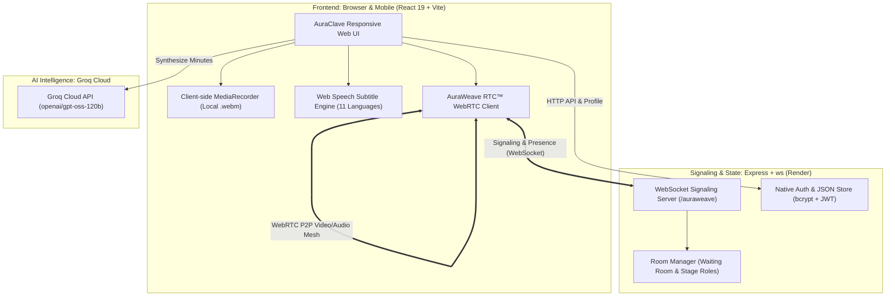

<div align="center">

  

  # 🌟 AuraClave
  ### The Free, AI-Powered Video Meeting Platform for Everyone
  *Zero Cost Forever • 1,000 Participants • Multilingual Subtitles • Executive AI Notes*

  [](https://auraclave-app-1081.web.app)
  [](#)
  [](https://react.dev/)
  [](https://groq.com/)
  [](#)
  [](LICENSE)

</div>

---

## 📖 What is AuraClave? (Explained for Everyone)

Imagine having a video meeting app like **Zoom** or **Google Meet**, but:
- ❌ **No 40-minute time limits** cutting your conversation short.
- ❌ **No expensive subscriptions** or \$30/month AI fees.
- ❌ **No software to download or install** — just open a browser link on any phone, tablet, or laptop and you're in.
- ❌ **No cloud storage limits or privacy leaks** — meetings record directly to your own device.

**AuraClave** is designed so anyone — whether you are a student, teacher, small business owner, community organizer, or enterprise leader — can host high-quality video calls with up to **1,000 people** completely free.

---

## 💡 Why Did We Build This?

Big tech companies charge heavy monthly fees for video conferencing. If you want AI meeting summaries or more than 100 people, Zoom and Microsoft Teams demand enterprise licenses and cloud add-ons. 

AuraClave solves this by introducing **AuraWeave RTC™** — an intelligent, self-hosted WebRTC communication engine that connects participants directly without routing terabytes of video through expensive media servers. 

The result? **World-class video meetings with $0.00 cloud media bills forever.**

---

## ✨ Key Features at a Glance

### 👥 1. Up to 1,000 Participants with "Stage & Audience" Mode
Host webinars, all-hands meetings, town halls, or online classrooms effortlessly:
- 🎙️ **Stage (Host & Presenters)**: Speak, share camera video in HD, share screens, and present slides.
- 🎧 **Audience (Up to 1,000 Attendees)**: Watch and listen with crystal-clear audio, follow live subtitles, and read AI meeting minutes.
- ✋ **Raise Hand & Speak**: Any audience member can click **"Raise Hand"**. The host can bring them onto the Stage with one click to speak or ask questions live!

### 📝 2. Human-Like AI Meeting Notes (Powered by Groq)
Never worry about taking notes during a call again:
- Click **"AI Notes"** at any point.
- Within **half a second**, high-speed Groq AI synthesizes everything said into clean, executive meeting minutes.
- Includes:
  - 🗓️ **Meeting Overview**
  - 📌 **Executive Summary**
  - 💡 **Key Takeaways & Decisions**
  - 🚀 **Next Steps & Action Items**
- Written in natural, warm, professional language (just like an executive Chief of Staff).

### 🌐 3. Live Subtitles in 11 Indian Languages
Break language barriers in real-time. AuraClave listens to speakers and broadcasts live closed captions (CC) across:
- **English, Hindi (हिंदी), Telugu (తెలుగు), Tamil (தமிழ்), Kannada (ಕನ್ನಡ), Malayalam (മലയാളം), Marathi (मराठी), Bengali (বাংলা), Gujarati (ગુજરાતી), Punjabi (ਪੰਜਾਬੀ), and Odia (ଓଡ଼ିଆ)**.

### 🖥️ 4. Independent Screen Sharing
- Share your full screen, browser tabs, slides, or software.
- Works **100% independently** — you can share your screen whether your webcam is turned ON or OFF.

### 🔴 5. Instant Private Recording (Zero Server Costs)
- Click **"Record"** at any time.
- AuraClave mixes microphone audio, speaker audio, and screen video together directly in your browser.
- When you stop, the `.webm` recording downloads straight to your computer's Downloads folder.
- **100% private**: Nothing is ever uploaded to a third-party cloud server.

### 🚪 6. Smart Waiting Room & Host Admission Control
- Choose between **"Open to All"** (anyone with the link can join instantly) or **"Require Host Approval"** (knocking system).
- Host gets an instant popup to **Admit** or **Decline** guests before they enter.

---

## 📊 How AuraClave Compares to Big Tech

| Feature | 🌟 **AuraClave** | 🟦 **Zoom / Webex** | 🟩 **Google Meet / MS Teams** |
| :--- | :--- | :--- | :--- |
| **Price** | **$0.00 Forever** | $15 – $25/host/mo | $6 – $30/user/mo |
| **Max Capacity** | **1,000 Attendees** (Stage + Audience) | 100 (Free), 300+ (Paid) | 100 (Free), 500+ (Paid) |
| **Time Limit** | **Unlimited** (No cutoff) | 40-minute limit on free tier | 60-minute limit on free tier |
| **AI Meeting Minutes** | **Included Free** (Sub-second Groq AI) | Requires Zoom Pro + AI Add-on | Copilot requires **\$30/user/mo** |
| **Live Subtitles** | **11 Indian Languages + English** | English only (Dialects locked to paid) | Basic translation locked in Enterprise |
| **Meeting Recording** | **Instant Local Download** (0 server cost) | Stored on third-party cloud with storage caps | Requires Google One / OneDrive subscription |
| **Installation** | **None** (Works in Chrome, Edge, Safari, Brave) | Requires desktop software download | Requires app installation or heavy web client |
| **Media Server Cost** | **$0.00** (AuraWeave RTC™ Mesh) | Heavy corporate cloud overhead | Cloud subscription lock-in |

---

## 🏗️ System Architecture

AuraClave operates on a modern, ultra-efficient distributed architecture designed for maximum performance with minimum resource usage:



### 🧠 How AuraWeave RTC™ Works

1. **Lightweight WebSocket Signaling**:
   When you join a room, your browser establishes a low-bandwidth WebSocket connection to the backend. This handles join handshakes, role promotions, and connection negotiations.
2. **Direct Peer-to-Peer Stage Streaming**:
   Stage members (Hosts & Presenters) stream their encrypted video and audio directly using native WebRTC peer connections.
3. **Audience Broadcast Distribution**:
   Audience members receive stage video/audio streams passively, maintaining minimal upstream bandwidth consumption for the presenter.
4. **Sub-second Groq AI Processing**:
   When **AI Notes** is triggered, meeting conversation notes are sent to Groq's high-speed inference engine (`openai/gpt-oss-120b`), returning structured executive minutes in under 500 milliseconds.

---

## 🚀 Quick Start (Run it Yourself in 3 Steps)

### Prerequisites
- Node.js (v18 or higher)
- Free [Groq API Key](https://console.groq.com/) for AI Meeting Summaries

### 1. Clone the Repository
```bash
git clone https://github.com/Nikhil1081/AuraClave.git
cd AuraClave_Project
```

### 2. Setup the Backend
```bash
cd backend
npm install
```

Create a `.env` file inside `backend/`:
```env
PORT=5000
JWT_SECRET=your-random-secret-key
GROQ_API_KEY=your_groq_api_key_here
GROQ_MODEL=openai/gpt-oss-120b
```

Start the backend:
```bash
npm run dev
```

### 3. Setup the Frontend
In a new terminal:
```bash
cd nexmeet
npm install
npm run dev
```

Open your browser at **`http://localhost:5173`** and create your first meeting room!

---

## 🌐 Live Production Deployments

- **Frontend Web App**: Hosted on Firebase Hosting  
  👉 [https://auraclave-app-1081.web.app](https://auraclave-app-1081.web.app)
- **Signaling & AI API**: Hosted on Render  
  👉 `https://auraclave-api.onrender.com`

---

## 📁 Repository Directory Overview

```text
AuraClave_Project/
├── backend/
│   ├── data/
│   │   └── users.json          # Persistent user database store
│   ├── src/
│   │   ├── auraweave.ts        # AuraWeave RTC™ 1K Signaling & Stage Engine
│   │   ├── auth.ts             # JWT authentication & session verification
│   │   ├── db.ts               # User password hashing & atomic storage
│   │   ├── roomManager.ts      # Host admission & waiting room queues
│   │   └── server.ts           # Express API & Groq AI endpoint
│   ├── package.json
│   └── render.yaml             # Zero-config Render deployment recipe
│
├── nexmeet/
│   ├── src/
│   │   ├── components/
│   │   │   ├── AuraWeaveConference.tsx   # 1,000-capacity Conference UI
│   │   │   ├── HostAdmissionBanner.tsx   # Host knock approval banner
│   │   │   ├── LanguageSelector.tsx      # 11 Indian language switcher
│   │   │   ├── ProfileModal.tsx          # Custom DP with canvas compression
│   │   │   └── ShareMeetingModal.tsx     # One-click link sharing modal
│   │   ├── contexts/
│   │   │   ├── AuthContext.tsx           # User authentication state
│   │   │   └── LanguageContext.tsx       # Multilingual translations
│   │   ├── lib/
│   │   │   ├── auraweave.ts              # AuraWeave RTC™ WebRTC hook
│   │   │   └── auth.ts                   # Token & session utilities
│   │   ├── pages/
│   │   │   ├── Dashboard.tsx             # User hub & quick meeting launcher
│   │   │   ├── Meeting.tsx               # Meeting admission validator
│   │   │   └── Home.tsx                  # Landing page
│   │   ├── App.tsx
│   │   ├── index.css                     # Glassmorphic dark theme styles
│   │   └── main.tsx
│   ├── firebase.json                     # Firebase Hosting configuration
│   └── package.json
│
└── README.md
```

---

## 🔒 Security & Privacy Commitments

- **Zero Cloud Recording Exposure**: Recordings stay on your machine. We never store meeting videos on our servers.
- **Client-Side Profile Image Compression**: Custom profile pictures are compressed to lightweight 160×160 thumbnails directly on your device before saving.
- **Slender JWT Auth**: Authentication tokens are kept minimal to prevent header bloat and guarantee rapid page loads.
- **Encrypted Media**: Real-time video and audio streams are encrypted end-to-end via WebRTC DTLS-SRTP standards.

---

## 🤝 Contributing & License

Contributions, bug reports, and suggestions are warmly welcomed!
1. Fork the Project.
2. Create your Feature Branch (`git checkout -b feature/AmazingFeature`).
3. Commit your Changes (`git commit -m 'feat: Add AmazingFeature'`).
4. Push to the Branch (`git push origin feature/AmazingFeature`).
5. Open a Pull Request.

Distributed under the **MIT License**. See `LICENSE` for more information.

---

<div align="center">
  <sub>Built with ❤️ to connect communities and people worldwide with zero cost.</sub>
</div>
