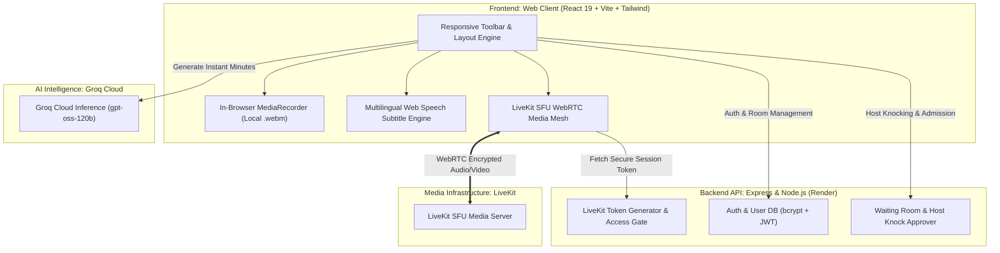

<div align="center">

  

  # 🌟 AuraClave
  ### The AI-Powered, Seamless Video Meeting Platform for Everyone
  *Zero hassle • Real-time video • Multilingual live subtitles • Sub-second AI notes • Custom rooms*

  [](https://auraclave-app-1081.web.app)
  [](#)
  [](https://react.dev/)
  [](https://groq.com/)
  [](LICENSE)

  <p align="center">
    <a href="#-about-auraclave">About</a> •
    <a href="#-key-features">Features</a> •
    <a href="#-interactive-responsive-toolbar">Toolbar Controls</a> •
    <a href="#-quick-start-run-locally">Quick Start</a> •
    <a href="#-architecture">Architecture</a> •
    <a href="#-privacy--security">Privacy</a>
  </p>

</div>

---

## 📖 About AuraClave

**AuraClave** is a modern, lightweight, browser-based video meeting experience built to make digital communication accessible, smart, and delightfully simple for everyone — students, remote teams, teachers, and creators.

Traditional conferencing apps often suffer from clunky downloads, restrictive 40-minute paywalls, steep subscription costs, and privacy concerns with cloud video storage. **AuraClave changes that**:

- 🚀 **Zero Downloads**: Open your meeting link directly in Chrome, Edge, Safari, Brave, or Firefox. No installer, no clutter.
- 🎯 **No Artificial Time Caps**: Jump in, brainstorm, and collaborate without an arbitrary timer cutting you off.
- 🔒 **100% Private Local Recordings**: Record your meetings right into your browser with instant `.webm` downloads. Nothing is uploaded or stored on third-party recording servers.
- 🤖 **Executive AI Notes in Half a Second**: Powered by Groq ultra-fast inference, convert discussions into clean, actionable executive minutes at the touch of a button.
- 🇮🇳 **Live Subtitles in 11 Indian Languages**: Real-time closed captions across English, Hindi, Tamil, Telugu, Kannada, Malayalam, Marathi, Bengali, Gujarati, Punjabi, and Odia.
- 🎛️ **Adaptive Control Surface**: Responsive meeting toolbar that seamlessly transitions between desktop large labels and compact icon-only rows with one-click collapse/expand handles.

---

## ✨ Key Features

### 🎛️ 1. Interactive & Responsive Meeting Control Toolbar
- **Desktop Large Mode by Default**: Clearly labeled vertical buttons (*Mute, Camera, Share, Layout, Captions, Record, Chat, AI Notes, Leave*) with high-contrast accessibility.
- **Auto-Switching Compact Mode**: Automatically adapts to compact icon-only circular buttons when screen width is constrained, keeping the toolbar in a single sleek horizontal row without breaking or wrapping.
- **Manual Collapse & Expand**: Features an intuitive top-center arrow handle (`⌄`) to hide the toolbar completely for distraction-free presentations, leaving a discreet restoration pill (`⌃`).

### 🏷️ 2. Customizable Meeting Names
- Start personalized meetings straight from your dashboard (e.g., *"Nikhil's Sprint Review"* or *"Design Sync"*).
- Hosts can click and edit the room title live inside the meeting header anytime.

### 📝 3. Instant AI Meeting Minutes (Powered by Groq)
- One-click **"AI Notes"** synthesizes speech transcripts and chat conversations into structured executive summaries:
  - 🗓️ **Meeting Context & Purpose**
  - 📌 **Executive Overview**
  - 💡 **Key Decisions & Takeaways**
  - 🚀 **Action Items & Owners**

### 🌐 4. Multilingual Live Subtitles (11 Languages)
- Real-time speech recognition streams closed captions across **English, Hindi (हिंदी), Telugu (తెలుగు), Tamil (தமிழ்), Kannada (ಕನ್ನಡ), Malayalam (മലയാളം), Marathi (मराठी), Bengali (বাংলা), Gujarati (ગુજરાતી), Punjabi (ਪੰਜਾਬੀ), and Odia (ଓଡ଼ିଆ)**.

### 🖥️ 5. Independent Screen Sharing & Layouts
- Share presentations, slides, coding editors, or browser tabs independently of whether your webcam is on or off.
- Supports Gallery Grid, Focus Mode, Speaker Spotlight, and Picture-in-Picture.

### 🔴 6. Zero-Cost Client-Side Recording
- Records both video streams and combined microphone/speaker audio directly inside your browser.
- Instant download upon stopping — eliminates recording storage fees and guarantees absolute confidentiality.

### 🚪 7. Waiting Room & Host Admission Control
- Toggle between **"Open to All"** and **"Require Host Approval"** (knocking queue) to protect meetings from unwanted drop-ins.

---

## 📊 How AuraClave Compares

| Feature | 🌟 **AuraClave** | 🟦 **Zoom / Webex** | 🟩 **Google Meet / Teams** |
| :--- | :--- | :--- | :--- |
| **Setup Required** | **None** (100% Web-based) | Heavy desktop client download | Account/Suite setup |
| **Meeting Names** | **Customizable** anytime | Fixed / auto IDs | Calendar-bound |
| **Time Restrictions** | **No platform timer** | 40-minute limit on free tier | 60-minute limit on free tier |
| **AI Meeting Minutes** | **Included** (Sub-second Groq AI) | Paid Add-on ($15+/mo) | Copilot / Gemini ($20–30/user/mo) |
| **Live Subtitles** | **11 Indian Languages + English** | English standard | English + limited tiers |
| **Recording Privacy** | **100% Local Download** | Cloud server storage with caps | Cloud drive quota consumption |
| **Media Engine** | **LiveKit SFU** (Scalable & Secure) | Proprietary cloud | Proprietary cloud |

---

## 🏗️ Architecture



---

## 🚀 Quick Start (Run Locally)

### Prerequisites
- [Node.js](https://nodejs.org/) (v18 or higher)
- Free [Groq API Key](https://console.groq.com/) for AI Meeting Summaries
- A LiveKit Cloud project or self-hosted LiveKit instance

### 1. Clone the Repository
```bash
git clone https://github.com/Nikhil1081/AuraClave.git
cd AuraClave_Project
```

### 2. Configure & Run Backend
```bash
cd backend
npm install
```

Create a `.env` file in `backend/`:
```env
PORT=5000
JWT_SECRET=your_jwt_secret_here
GROQ_API_KEY=your_groq_api_key_here
GROQ_MODEL=openai/gpt-oss-120b
LIVEKIT_URL=wss://your-livekit-server.com
LIVEKIT_API_KEY=your_livekit_api_key
LIVEKIT_API_SECRET=your_livekit_api_secret
```

Start the API:
```bash
npm run dev
```

### 3. Configure & Run Frontend
In another terminal:
```bash
cd nexmeet
npm install
npm run dev
```

Open your browser at **`http://localhost:5173`** and launch your custom meeting!

---

## 🌐 Deployments

- **Live Web Application**: Hosted with Firebase Hosting  
  👉 **[https://auraclave-app-1081.web.app](https://auraclave-app-1081.web.app)**
- **Production Backend API**: Hosted on Render  
  👉 `https://auraclave-api.onrender.com`

---

## 🔒 Privacy & Security

- **End-to-End Media Encryption**: LiveKit uses WebRTC DTLS-SRTP transport encryption for all camera, audio, and screen feeds.
- **Client-Side Profile Processing**: Custom avatars and profile images are cropped and compressed into lightweight thumbnails locally on your browser before storage.
- **Minimal JWT Sessions**: Stateless, lightweight tokens eliminate bloated request headers and keep navigation snappy.
- **Your Data Remains Yours**: AuraClave never uploads, processes, or stores your local meeting video recordings on external cloud buckets.

---

## 🤝 Contributing

Contributions, feature suggestions, and feedback are welcome!
1. Fork the Project
2. Create your Feature Branch (`git checkout -b feature/NewFeature`)
3. Commit your Changes (`git commit -m 'feat: Add NewFeature'`)
4. Push to the Branch (`git push origin feature/NewFeature`)
5. Open a Pull Request

---

## 📜 License

Distributed under the **MIT License**. See `LICENSE` for details.

<div align="center">
  <sub>Crafted with ❤️ to empower seamless, intelligent conversations worldwide.</sub>
</div>
