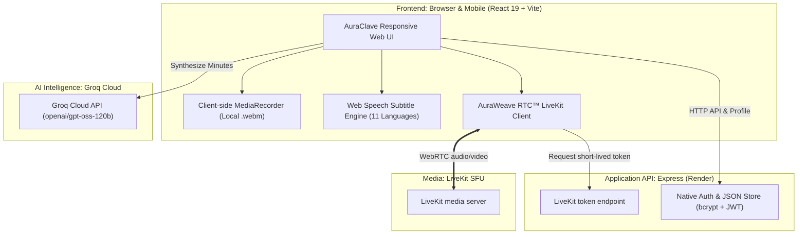

<div align="center">

  

  # 🌟 AuraClave
  ### The AI-Powered Video Meeting Platform for Everyone
  *Simple meetings • LiveKit-powered video • Multilingual subtitles • Executive AI notes*

  [](https://auraclave-app-1081.web.app)
  [](#)
  [](https://react.dev/)
  [](https://groq.com/)
  [](#)
  [](LICENSE)

</div>

---

## 📖 What is AuraClave? (Explained for Everyone)

Imagine having a video meeting app like **Zoom** or **Google Meet**, but easy to run:
- No desktop application is required; open the meeting link in a modern browser.
- Every participant can use their microphone, camera, and screen sharing.
- Meetings do not have a built-in timer in AuraClave.
- Recordings stay on the participant's device instead of being uploaded by AuraClave.

**AuraClave** is a browser-based meeting project for students, teachers, small
businesses, and communities. It includes a meeting view, chat, local recording,
captions, and AI-generated notes.

---

## 💡 Why Did We Build This?

AuraClave uses **AuraWeave RTC™** as the name for its meeting media layer.
AuraWeave now uses **LiveKit**, an SFU (Selective Forwarding Unit). Each
participant sends audio and video once to LiveKit, which forwards it to the
other participants. This is more practical for larger meetings than making
every browser connect directly to every other browser.

LiveKit can be self-hosted with its Community Edition or used through LiveKit
Cloud. The hosting provider, bandwidth, and LiveKit plan determine the actual
capacity and cost.

---

## ✨ Key Features at a Glance

### 👥 1. Participant-based meetings
Every participant can:
- Turn their microphone on or off.
- Start or stop their camera.
- Share their screen independently of their camera.
- Hear and see other participants through the LiveKit SFU.
- Use chat and leave the meeting at any time.

### 📝 2. Human-Like AI Meeting Notes (Powered by Groq)
Never worry about taking notes during a call again:
- Click **"AI Notes"** at any point.
- Within **half a second**, high-speed Groq AI synthesizes everything said into clean, executive meeting minutes.
- Includes:
  - 🗓️ **Meeting Overview**
  - 📌 **Executive Summary**
  - 💡 **Key Takeaways & Decisions**
  - 🚀 **Next Steps & Action Items**
- Written in natural, warm, professional language (just like an executive Chief of Staff).

### 🌐 3. Live Subtitles in 11 Indian Languages
Break language barriers in real-time. AuraClave listens to speakers and broadcasts live closed captions (CC) across:
- **English, Hindi (हिंदी), Telugu (తెలుగు), Tamil (தமிழ்), Kannada (ಕನ್ನಡ), Malayalam (മലയാളം), Marathi (मराठी), Bengali (বাংলা), Gujarati (ગુજરાતી), Punjabi (ਪੰਜਾਬੀ), and Odia (ଓଡ଼ିଆ)**.

### 🖥️ 4. Independent Screen Sharing
- Share your full screen, browser tabs, slides, or software.
- Works **100% independently** — you can share your screen whether your webcam is turned ON or OFF.

### 🔴 5. Instant Private Recording (Zero Server Costs)
- Click **"Record"** at any time.
- AuraClave mixes microphone audio, speaker audio, and screen video together directly in your browser.
- When you stop, the `.webm` recording downloads straight to your computer's Downloads folder.
- **100% private**: Nothing is ever uploaded to a third-party cloud server.

### 🚪 6. Smart Waiting Room & Host Admission Control
- Choose between **"Open to All"** (anyone with the link can join instantly) or **"Require Host Approval"** (knocking system).
- Host gets an instant popup to **Admit** or **Decline** guests before they enter.

---

## 📊 How AuraClave Compares to Big Tech

| Feature | 🌟 **AuraClave** | 🟦 **Zoom / Webex** | 🟩 **Google Meet / MS Teams** |
| :--- | :--- | :--- | :--- |
| **Price** | Depends on your LiveKit hosting choice | $15 – $25/host/mo | $6 – $30/user/mo |
| **Capacity** | Depends on LiveKit hosting and server resources | Depends on plan | Depends on plan |
| **Time Limit** | No application timer; provider limits may apply | Depends on plan | Depends on plan |
| **AI Meeting Minutes** | **Included Free** (Sub-second Groq AI) | Requires Zoom Pro + AI Add-on | Copilot requires **\$30/user/mo** |
| **Live Subtitles** | **11 Indian Languages + English** | English only (Dialects locked to paid) | Basic translation locked in Enterprise |
| **Meeting Recording** | **Instant Local Download** (0 server cost) | Stored on third-party cloud with storage caps | Requires Google One / OneDrive subscription |
| **Installation** | **None** (Works in Chrome, Edge, Safari, Brave) | Requires desktop software download | Requires app installation or heavy web client |
| **Media architecture** | LiveKit SFU (self-hosted or LiveKit Cloud) | Provider-managed | Provider-managed |

---

## 🏗️ System Architecture

AuraClave operates on a modern, ultra-efficient distributed architecture designed for maximum performance with minimum resource usage:



### 🧠 How AuraWeave RTC™ Works

1. **Secure room access**:
   The browser signs in to the Express API and requests a short-lived LiveKit
   participant token. The API secret stays on Render and is never sent to the
   browser.
2. **LiveKit SFU media**:
   The browser connects to LiveKit for encrypted audio, camera video, and
   screen sharing. Everyone uses the same participant permissions.
3. **Automatic token refresh**:
   The browser requests a fresh token before the current one expires and
   reconnects while restoring the active microphone, camera, and screen share.
4. **Sub-second Groq AI Processing**:
   When **AI Notes** is triggered, meeting conversation notes are sent to Groq's high-speed inference engine (`openai/gpt-oss-120b`), returning structured executive minutes in under 500 milliseconds.

---

## 🚀 Quick Start (Run it Yourself in 3 Steps)

### Prerequisites
- Node.js (v18 or higher)
- Free [Groq API Key](https://console.groq.com/) for AI Meeting Summaries
- A LiveKit Cloud project, or a self-hosted LiveKit Community Edition server

### 1. Clone the Repository
```bash
git clone https://github.com/Nikhil1081/AuraClave.git
cd AuraClave_Project
```

### 2. Setup the Backend
```bash
cd backend
npm install
```

Create a `.env` file inside `backend/`:
```env
PORT=5000
JWT_SECRET=your-random-secret-key
GROQ_API_KEY=your_groq_api_key_here
GROQ_MODEL=openai/gpt-oss-120b
LIVEKIT_URL=wss://your-livekit-host.example.com
LIVEKIT_API_KEY=your-livekit-api-key
LIVEKIT_API_SECRET=your-livekit-api-secret
```

Start the backend:
```bash
npm run dev
```

### 3. Setup the Frontend
In a new terminal:
```bash
cd nexmeet
npm install
npm run dev
```

Open your browser at **`http://localhost:5173`** and create your first meeting room!

The frontend talks to the local backend through the existing Vite development
configuration. If the API runs on another address, update the frontend API
configuration before starting it.

---

## 🌐 Live Production Deployments

- **Frontend Web App**: Hosted on Firebase Hosting  
  👉 [https://auraclave-app-1081.web.app](https://auraclave-app-1081.web.app)
- **Application & AI API**: Hosted on Render
  👉 `https://auraclave-api.onrender.com`

### LiveKit SFU setup

AuraWeave now uses LiveKit Community Edition as its media SFU. The LiveKit server
must run separately from the Render API on a host that supports TCP and UDP
WebRTC ports. The repository includes [`docker-compose.livekit.yml`](./docker-compose.livekit.yml)
and [`livekit.yaml`](./livekit.yaml) for a self-hosted deployment.

Set these values in the Render API environment:

```text
LIVEKIT_URL=wss://your-livekit-host.example.com
LIVEKIT_API_KEY=your-generated-key
LIVEKIT_API_SECRET=your-generated-secret
```

Do not expose `LIVEKIT_API_SECRET` to Firebase or frontend code. Until these
variables point to a running LiveKit server, the API will return
`LiveKit SFU is not configured on the server` and meetings will not connect.

For LiveKit Cloud, copy the WebSocket URL, API key, and API secret from the
LiveKit project dashboard. For self-hosting, use the included
[`docker-compose.livekit.yml`](./docker-compose.livekit.yml) and
[`livekit.yaml`](./livekit.yaml) on a machine with publicly reachable TCP and
UDP WebRTC ports. A normal Render web service is not a complete self-hosted
LiveKit media server.

### Deploying the project

1. **Render** runs the `backend` API. Add `JWT_SECRET`, `GROQ_API_KEY`,
   `LIVEKIT_URL`, `LIVEKIT_API_KEY`, and `LIVEKIT_API_SECRET` as environment
   variables in Render. Keep API secrets only on Render.
2. **Firebase Hosting** serves the built `nexmeet` frontend. Firebase contains
   public browser code, so never put `LIVEKIT_API_SECRET`, `JWT_SECRET`, or
   other private keys there.
3. After changing backend variables, save them in Render and redeploy the
   backend. After changing frontend code, build and deploy the frontend with
   `npm run build` and the Firebase Hosting deploy command.

The frontend refreshes participant tokens automatically during long meetings.
This prevents normal application token expiry from ending a meeting, but it
does not bypass LiveKit Cloud quotas, billing, server capacity, browser limits,
or network interruptions.

---

## 📁 Repository Directory Overview

```text
AuraClave_Project/
├── backend/
│   ├── data/
│   │   └── users.json          # Persistent user database store
│   ├── src/
│   │   ├── auraweave.ts        # Legacy signaling code retained for reference
│   │   ├── auth.ts             # JWT authentication & session verification
│   │   ├── db.ts               # User password hashing & atomic storage
│   │   ├── roomManager.ts      # Host admission & waiting room queues
│   │   └── server.ts           # Express API & Groq AI endpoint
│   ├── package.json
│   └── render.yaml             # Zero-config Render deployment recipe
│
├── nexmeet/
│   ├── src/
│   │   ├── components/
│   │   │   ├── AuraWeaveConference.tsx   # Meeting participant and media UI
│   │   │   ├── HostAdmissionBanner.tsx   # Host knock approval banner
│   │   │   ├── LanguageSelector.tsx      # 11 Indian language switcher
│   │   │   ├── ProfileModal.tsx          # Custom DP with canvas compression
│   │   │   └── ShareMeetingModal.tsx     # One-click link sharing modal
│   │   ├── contexts/
│   │   │   ├── AuthContext.tsx           # User authentication state
│   │   │   └── LanguageContext.tsx       # Multilingual translations
│   │   ├── lib/
│   │   │   ├── auraweave.ts              # LiveKit SFU client adapter
│   │   │   └── auth.ts                   # Token & session utilities
│   │   ├── pages/
│   │   │   ├── Dashboard.tsx             # User hub & quick meeting launcher
│   │   │   ├── Meeting.tsx               # Meeting admission validator
│   │   │   └── Home.tsx                  # Landing page
│   │   ├── App.tsx
│   │   ├── index.css                     # Glassmorphic dark theme styles
│   │   └── main.tsx
│   ├── firebase.json                     # Firebase Hosting configuration
│   └── package.json
│
└── README.md
```

---

## 🔒 Security & Privacy Commitments

- **Local recording**: Recordings stay on your machine. AuraClave does not upload meeting videos.
- **Client-Side Profile Image Compression**: Custom profile pictures are compressed to lightweight 160×160 thumbnails directly on your device before saving.
- **Slender JWT Auth**: Authentication tokens are kept minimal to prevent header bloat and guarantee rapid page loads.
- **Encrypted media transport**: LiveKit uses WebRTC DTLS-SRTP encryption while media travels between browsers and the SFU. This is transport encryption, not a promise of end-to-end encryption from the application.

---

## 🤝 Contributing & License

Contributions, bug reports, and suggestions are warmly welcomed!
1. Fork the Project.
2. Create your Feature Branch (`git checkout -b feature/AmazingFeature`).
3. Commit your Changes (`git commit -m 'feat: Add AmazingFeature'`).
4. Push to the Branch (`git push origin feature/AmazingFeature`).
5. Open a Pull Request.

Distributed under the **MIT License**. See `LICENSE` for more information.

---

<div align="center">
  <sub>Built with ❤️ to connect communities and people worldwide.</sub>
</div>
