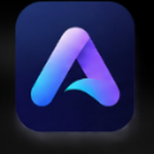

<div align="center">

  

  # AuraClave

  **AI-Powered Video Collaboration for a Multilingual World**  
  *Connect Without Limits.*

  [](https://auraclave-app-1081.web.app)
  [](https://react.dev/)
  [](https://livekit.io/)
  [](https://groq.com/)
  [](https://supabase.com/)
  [](LICENSE)

</div>

---

## 📌 Overview

**AuraClave** is a lightweight, privacy-focused, real-time video conferencing platform built to break communication barriers. 

While legacy tools like Zoom, Microsoft Teams, and Google Meet are heavy, expensive, and primarily focused on English-speaking corporate environments, AuraClave delivers **hyper-local multilingual intelligence** with **zero recurring cloud storage fees** and **sub-second AI processing**.

### ✨ Core Pillars
1. **🌐 Hyper-Local Multilingual Speech-to-Text**: Real-time subtitles in **11 Indian languages** (Hindi, Telugu, Tamil, Kannada, Malayalam, Marathi, Bengali, Gujarati, Punjabi, Odia, and English) transmitted over WebRTC Data Channels.
2. **🤖 Sub-Second AI Meeting Intelligence**: Powered by **Groq Cloud (LLaMA 3.3 70B)** to automatically generate structured Executive Summaries, Key Decisions, and Action Items in your chosen language.
3. **🔒 100% Private Client-Side Recording**: Direct browser-to-disk recording using the native `MediaRecorder` API. Zero server storage costs, zero cloud data leaks.
4. **⚡ Ultra-Lightweight & Fast**: Built with React 19, Vite, and LiveKit SFU. Joins meetings in under 2 seconds without installing executables.

---

## 🚀 Live Demo

* **Web Application**: [https://auraclave-app-1081.web.app](https://auraclave-app-1081.web.app)
* **Backend API**: Hosted on Render (`https://auraclave-api.onrender.com`)

---

## 📊 AuraClave vs Big Tech Competitors

| Feature | **AuraClave** | **Zoom / Webex** | **MS Teams / Google Meet** | **Zoho Meeting** |
| :--- | :--- | :--- | :--- | :--- |
| **Regional Language Native** | **11 Indian languages** (UI, live captions, & AI summaries) | Limited regional dialect transcription | Basic translation; locked behind enterprise tier | Standard English / European languages |
| **AI Availability & Cost** | **Free & open** via Groq (LLaMA 3.3 70B) | Requires Zoom Pro + AI Companion add-ons | Copilot requires **\$30/user/month** license | Basic AI in top-tier plans |
| **Recording & Privacy** | **Client-side local recording**: 0 cloud exposure, instant `.webm` download | Stored on third-party servers; paid storage limits | Stored in OneDrive / Google Drive; admin restricted | Stored on Zoho servers with storage caps |
| **System Footprint** | **100% Web-Native**; instant joining without bloated app downloads | Heavy desktop clients with frequent updates | High memory consumption (Electron / WebView) | Web-based, but requires plugins for certain tools |
| **Deployment Model** | **Modular & White-Label ready** (LiveKit + Supabase + Groq) | Proprietary closed ecosystem | Closed enterprise walled-garden | Proprietary SaaS |

---

## 🏗️ Architecture

```
[ User Browser ]
       │
       ├─► Supabase Auth (JWT Session Verification)
       ├─► LiveKit SFU (Ultra-Low Latency Audio, HD Video & Screen Sharing)
       ├─► Web Speech Engine (Continuous Multilingual Speech-to-Text)
       ├─► WebRTC Data Channels (Live Peer-to-Peer Subtitle Broadcasting)
       ├─► MediaRecorder Engine (Direct Browser-to-Disk .webm Capture)
       │
[ Express / Node Backend ] (Render)
       │
       ├─► Token Service (Cryptographically signed LiveKit Access Tokens)
       └─► Groq AI Service (LLaMA 3.3 70B Versatile for Action Items & Minutes)
```

---

## 🛠️ Tech Stack

- **Frontend**: React 19, TypeScript, Vite, Tailwind CSS v4, Lucide Icons, Framer Motion
- **Real-Time Video/Audio**: LiveKit Client & Components (`@livekit/components-react`)
- **Backend**: Express.js, TypeScript, LiveKit Server SDK
- **Authentication**: Supabase Auth (JWT validation)
- **AI Engine**: Groq Cloud SDK (`llama-3.3-70b-versatile`)
- **Deployment**: Firebase Hosting (Frontend), Render (Backend API)

---

## 📂 Project Structure

```bash
AuraClave_Project/
├── backend/                  # Express + LiveKit Server SDK + Groq AI API
│   ├── src/
│   │   ├── auth.ts           # Supabase JWT token verification
│   │   └── server.ts         # /api/token & /api/ai endpoints
│   ├── package.json
│   ├── tsconfig.json
│   └── render.yaml           # One-click Render deployment configuration
│
├── nexmeet/                  # React 19 Frontend Web Application
│   ├── public/
│   │   └── assets/           # Logos, app icons, and branding
│   ├── src/
│   │   ├── components/       # Brand, LanguageSelector, MeetingExtensions, Protected
│   │   ├── contexts/         # AuthContext, LanguageContext (11 languages)
│   │   ├── lib/              # Supabase client initialization
│   │   ├── pages/            # Home, Auth, Dashboard, Meeting, Setup
│   │   ├── App.tsx           # Route definitions
│   │   └── index.css         # Custom dark theme & responsive UI
│   ├── firebase.json         # Firebase Hosting configuration
│   ├── .firebaserc           # Firebase project target
│   └── package.json
│
├── .gitignore
└── README.md
```

---

## ⚙️ Quickstart & Local Setup

### 1. Prerequisites
- **Node.js**: v20 or higher
- **npm** or **pnpm**
- Accounts with:
  - [LiveKit Cloud](https://cloud.livekit.io/) (Free tier available)
  - [Supabase](https://supabase.com/) (Free tier available)
  - [Groq](https://groq.com/) (Free fast LLaMA 3.3 inference)

---

### 2. Clone the Repository
```bash
git clone https://github.com/Nikhil1081/AuraClave.git
cd AuraClave
```

---

### 3. Setup Backend

1. Navigate to the backend folder:
   ```bash
   cd backend
   npm install
   ```

2. Create `.env` in `backend/`:
   ```env
   PORT=5000
   SUPABASE_URL=https://YOUR_PROJECT.supabase.co
   SUPABASE_ANON_KEY=YOUR_SUPABASE_ANON_KEY
   LIVEKIT_URL=wss://YOUR_PROJECT.livekit.cloud
   LIVEKIT_API_KEY=YOUR_LIVEKIT_API_KEY
   LIVEKIT_API_SECRET=YOUR_LIVEKIT_API_SECRET
   GROQ_API_KEY=YOUR_GROQ_API_KEY
   GROQ_MODEL=llama-3.3-70b-versatile
   ```

3. Start backend in development mode:
   ```bash
   npm run dev
   ```

---

### 4. Setup Frontend

1. Navigate to the frontend folder:
   ```bash
   cd ../nexmeet
   npm install
   ```

2. Create `.env.local` in `nexmeet/`:
   ```env
   VITE_SUPABASE_URL=https://YOUR_PROJECT.supabase.co
   VITE_SUPABASE_ANON_KEY=YOUR_SUPABASE_ANON_KEY
   VITE_API_URL=http://localhost:5000
   ```

3. Start frontend dev server:
   ```bash
   npm run dev
   ```
   Open [http://localhost:5173](http://localhost:5173) in your browser.

---

## 🌐 Supported Regional Languages

AuraClave natively supports speech recognition, live translation, and AI notes across 11 languages:

| Language | Native Script | Speech Code |
| :--- | :--- | :--- |
| **English** | English | `en-IN` |
| **Hindi** | हिन्दी | `hi-IN` |
| **Telugu** | తెలుగు | `te-IN` |
| **Tamil** | தமிழ் | `ta-IN` |
| **Kannada** | ಕನ್ನಡ | `kn-IN` |
| **Malayalam** | മലയാളം | `ml-IN` |
| **Marathi** | मराठी | `mr-IN` |
| **Bengali** | বাংলা | `bn-IN` |
| **Gujarati** | ગુજરાતી | `gu-IN` |
| **Punjabi** | ਪੰਜਾਬੀ | `pa-IN` |
| **Odia** | ଓଡ଼ିଆ | `or-IN` |

---

## 🚢 Deployment

### Frontend (Firebase Hosting)
```bash
cd nexmeet
npm run build
firebase deploy --only hosting
```

### Backend (Render)
1. Fork or push your repository to GitHub.
2. In Render, select **New Web Service** and connect the `backend` directory.
3. Add the environment variables (`LIVEKIT_URL`, `LIVEKIT_API_KEY`, `LIVEKIT_API_SECRET`, `SUPABASE_URL`, `SUPABASE_ANON_KEY`, `GROQ_API_KEY`).
4. Build command: `npm install && npm run build`
5. Start command: `npm start`

---

## 📄 License

This project is licensed under the [MIT License](LICENSE).

---

<div align="center">
  <sub>Built with ❤️ for inclusive, borderless communication.</sub>
</div>
