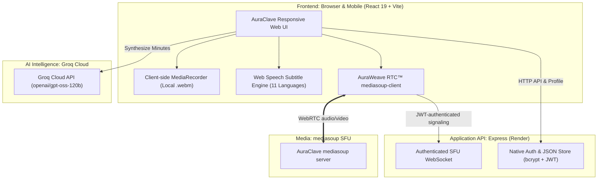

<div align="center">

  

  # 🌟 AuraClave
  ### The AI-Powered Video Meeting Platform for Everyone
  *Simple meetings • mediasoup-powered video • Multilingual subtitles • Executive AI notes*

  [](https://auraclave-app-1081.web.app)
  [](#)
  [](https://react.dev/)
  [](https://groq.com/)
  [](#)
  [](LICENSE)

</div>

---

## 📖 What is AuraClave? (Explained for Everyone)

Imagine having a video meeting app like **Zoom** or **Google Meet**, but easy to run:
- No desktop application is required; open the meeting link in a modern browser.
- Every participant can use their microphone, camera, and screen sharing.
- Meetings do not have a built-in timer in AuraClave.
- Recordings stay on the participant's device instead of being uploaded by AuraClave.

**AuraClave** is a browser-based meeting project for students, teachers, small
businesses, and communities. It includes a meeting view, chat, local recording,
captions, and AI-generated notes.

---

## 💡 Why Did We Build This?

AuraClave uses **AuraWeave RTC™** as the name for its meeting media layer.
AuraWeave now uses **mediasoup**, an open-source SFU (Selective Forwarding
Unit). Each participant sends audio and video once to the AuraClave server,
which forwards it to the other participants. This is more practical for larger
meetings than making every browser connect directly to every other browser.

mediasoup has no per-meeting or per-participant license fee. The server,
bandwidth, and hardware still determine the actual capacity and operating cost.

---

## ✨ Key Features at a Glance

### 👥 1. Participant-based meetings
Every participant can:
- Turn their microphone on or off.
- Start or stop their camera.
- Share their screen independently of their camera.
- Hear and see other participants through the mediasoup SFU.
- Use chat and leave the meeting at any time.

### 📝 2. Human-Like AI Meeting Notes (Powered by Groq)
Never worry about taking notes during a call again:
- Click **"AI Notes"** at any point.
- Within **half a second**, high-speed Groq AI synthesizes everything said into clean, executive meeting minutes.
- Includes:
  - 🗓️ **Meeting Overview**
  - 📌 **Executive Summary**
  - 💡 **Key Takeaways & Decisions**
  - 🚀 **Next Steps & Action Items**
- Written in natural, warm, professional language (just like an executive Chief of Staff).

### 🌐 3. Live Subtitles in 11 Indian Languages
Break language barriers in real-time. AuraClave listens to speakers and broadcasts live closed captions (CC) across:
- **English, Hindi (हिंदी), Telugu (తెలుగు), Tamil (தமிழ்), Kannada (ಕನ್ನಡ), Malayalam (മലയാളം), Marathi (मराठी), Bengali (বাংলা), Gujarati (ગુજરાતી), Punjabi (ਪੰਜਾਬੀ), and Odia (ଓଡ଼ିଆ)**.

### 🖥️ 4. Independent Screen Sharing
- Share your full screen, browser tabs, slides, or software.
- Works **100% independently** — you can share your screen whether your webcam is turned ON or OFF.

### 🔴 5. Instant Private Recording (Zero Server Costs)
- Click **"Record"** at any time.
- AuraClave mixes microphone audio, speaker audio, and screen video together directly in your browser.
- When you stop, the `.webm` recording downloads straight to your computer's Downloads folder.
- **100% private**: Nothing is ever uploaded to a third-party cloud server.

### 🚪 6. Smart Waiting Room & Host Admission Control
- Choose between **"Open to All"** (anyone with the link can join instantly) or **"Require Host Approval"** (knocking system).
- Host gets an instant popup to **Admit** or **Decline** guests before they enter.

---

## 📊 How AuraClave Compares to Big Tech

| Feature | 🌟 **AuraClave** | 🟦 **Zoom / Webex** | 🟩 **Google Meet / MS Teams** |
| :--- | :--- | :--- | :--- |
| **Price** | No mediasoup license fee; hosting still has costs | $15 – $25/host/mo | $6 – $30/user/mo |
| **Capacity** | Depends on server and network resources | Depends on plan | Depends on plan |
| **Time Limit** | No application timer; provider limits may apply | Depends on plan | Depends on plan |
| **AI Meeting Minutes** | **Included Free** (Sub-second Groq AI) | Requires Zoom Pro + AI Add-on | Copilot requires **\$30/user/mo** |
| **Live Subtitles** | **11 Indian Languages + English** | English only (Dialects locked to paid) | Basic translation locked in Enterprise |
| **Meeting Recording** | **Instant Local Download** (0 server cost) | Stored on third-party cloud with storage caps | Requires Google One / OneDrive subscription |
| **Installation** | **None** (Works in Chrome, Edge, Safari, Brave) | Requires desktop software download | Requires app installation or heavy web client |
| **Media architecture** | Self-hosted mediasoup SFU | Provider-managed | Provider-managed |

---

## 🏗️ System Architecture

AuraClave operates on a modern, ultra-efficient distributed architecture designed for maximum performance with minimum resource usage:



### 🧠 How AuraWeave RTC™ Works

1. **Secure room access**:
   The browser signs in to the Express API and opens a JWT-authenticated SFU
   WebSocket. The JWT secret stays on the server and is never sent to peers.
2. **mediasoup SFU media**:
   The browser connects to the AuraClave SFU for encrypted audio, camera video,
   and screen sharing. Everyone uses the same participant permissions.
3. **Long-running rooms**:
   There is no application meeting timer. A process manager can restart the
   backend/SFU after a crash or machine reboot.
4. **Sub-second Groq AI Processing**:
   When **AI Notes** is triggered, meeting conversation notes are sent to Groq's high-speed inference engine (`openai/gpt-oss-120b`), returning structured executive minutes in under 500 milliseconds.

---

## 🚀 Quick Start (Run it Yourself in 3 Steps)

### Prerequisites
- Node.js (v18 or higher)
- Free [Groq API Key](https://console.groq.com/) for AI Meeting Summaries
- A server or computer that can run a mediasoup SFU with public UDP/TCP ports

### 1. Clone the Repository
```bash
git clone https://github.com/Nikhil1081/AuraClave.git
cd AuraClave_Project
```

### 2. Setup the Backend
```bash
cd backend
npm install
```

Create a `.env` file inside `backend/`:
```env
PORT=5000
JWT_SECRET=your-random-secret-key
GROQ_API_KEY=your_groq_api_key_here
GROQ_MODEL=openai/gpt-oss-120b
MEDIASOUP_LISTEN_IP=0.0.0.0
MEDIASOUP_ANNOUNCED_IP=your-public-server-ip
MEDIASOUP_MIN_PORT=40000
MEDIASOUP_MAX_PORT=49999
```

Start the backend:
```bash
npm run dev
```

### 3. Setup the Frontend
In a new terminal:
```bash
cd nexmeet
npm install
npm run dev
```

Open your browser at **`http://localhost:5173`** and create your first meeting room!

The frontend talks to the local backend through the existing Vite development
configuration. If the API runs on another address, update the frontend API
configuration before starting it.

---

## 🌐 Live Production Deployments

- **Frontend Web App**: Hosted on Firebase Hosting  
  👉 [https://auraclave-app-1081.web.app](https://auraclave-app-1081.web.app)
- **Application & AI API**: Hosted on Render
  👉 `https://auraclave-api.onrender.com`

### Self-hosted mediasoup SFU setup

AuraWeave now uses mediasoup, a free and open-source SFU library, inside the
AuraClave backend. The backend serves authenticated WebSocket signaling at
`/api/sfu` and creates the WebRTC media transports. mediasoup does not charge
per meeting or per participant.

Set these values in the backend environment:

```text
MEDIASOUP_LISTEN_IP=0.0.0.0
MEDIASOUP_ANNOUNCED_IP=your-public-server-ip
MEDIASOUP_MIN_PORT=40000
MEDIASOUP_MAX_PORT=49999
```

A normal Render web service is not a suitable production mediasoup host because
the SFU needs persistent public UDP networking for WebRTC media. Run the
backend/SFU on a VPS, dedicated machine, or computer you control, and open the
configured UDP/TCP port range in its firewall.

### Deploying the project

1. **Your SFU host** runs the `backend` API and mediasoup. Add `JWT_SECRET`,
   `GROQ_API_KEY`, `MEDIASOUP_LISTEN_IP`, `MEDIASOUP_ANNOUNCED_IP`,
   `MEDIASOUP_MIN_PORT`, and `MEDIASOUP_MAX_PORT` as environment variables.
   Keep the host awake and the configured UDP/TCP ports open.
2. **Firebase Hosting** serves the built `nexmeet` frontend. Firebase contains
   public browser code, so never put `JWT_SECRET` or other private keys there.
3. If the API and SFU run on another host, set the frontend API URL to that
   host. An HTTP-only reverse proxy cannot replace the required WebRTC media
   ports.

The mediasoup connection has no application meeting timer. A meeting can run
for 5–6 hours or longer while the host, process, network, and participant
browsers remain available. Use systemd, PM2, or Docker with an automatic
restart policy so the backend/SFU starts after a reboot or recovers after a
crash. This removes software license fees, but it does not make CPU, bandwidth,
electricity, hardware, or participant capacity unlimited.

---

## 📁 Repository Directory Overview

```text
AuraClave_Project/
├── backend/
│   ├── data/
│   │   └── users.json          # Persistent user database store
│   ├── src/
│   │   ├── auraweave.ts        # Legacy signaling code retained for reference
│   │   ├── sfu.ts              # mediasoup worker, rooms, transports, and signaling
│   │   ├── auth.ts             # JWT authentication & session verification
│   │   ├── db.ts               # User password hashing & atomic storage
│   │   ├── roomManager.ts      # Host admission & waiting room queues
│   │   └── server.ts           # Express API & Groq AI endpoint
│   ├── package.json
│   └── render.yaml             # Zero-config Render deployment recipe
│
├── nexmeet/
│   ├── src/
│   │   ├── components/
│   │   │   ├── AuraWeaveConference.tsx   # Meeting participant and media UI
│   │   │   ├── HostAdmissionBanner.tsx   # Host knock approval banner
│   │   │   ├── LanguageSelector.tsx      # 11 Indian language switcher
│   │   │   ├── ProfileModal.tsx          # Custom DP with canvas compression
│   │   │   └── ShareMeetingModal.tsx     # One-click link sharing modal
│   │   ├── contexts/
│   │   │   ├── AuthContext.tsx           # User authentication state
│   │   │   └── LanguageContext.tsx       # Multilingual translations
│   │   ├── lib/
│   │   │   ├── auraweave.ts              # mediasoup-client SFU adapter
│   │   │   └── auth.ts                   # Token & session utilities
│   │   ├── pages/
│   │   │   ├── Dashboard.tsx             # User hub & quick meeting launcher
│   │   │   ├── Meeting.tsx               # Meeting admission validator
│   │   │   └── Home.tsx                  # Landing page
│   │   ├── App.tsx
│   │   ├── index.css                     # Glassmorphic dark theme styles
│   │   └── main.tsx
│   ├── firebase.json                     # Firebase Hosting configuration
│   └── package.json
│
└── README.md
```

---

## 🔒 Security & Privacy Commitments

- **Local recording**: Recordings stay on your machine. AuraClave does not upload meeting videos.
- **Client-Side Profile Image Compression**: Custom profile pictures are compressed to lightweight 160×160 thumbnails directly on your device before saving.
- **Slender JWT Auth**: Authentication tokens are kept minimal to prevent header bloat and guarantee rapid page loads.
- **Encrypted media transport**: mediasoup uses WebRTC DTLS-SRTP encryption while media travels between browsers and the SFU. This is transport encryption, not a promise of end-to-end encryption from the application.

---

## 🤝 Contributing & License

Contributions, bug reports, and suggestions are warmly welcomed!
1. Fork the Project.
2. Create your Feature Branch (`git checkout -b feature/AmazingFeature`).
3. Commit your Changes (`git commit -m 'feat: Add AmazingFeature'`).
4. Push to the Branch (`git push origin feature/AmazingFeature`).
5. Open a Pull Request.

Distributed under the **MIT License**. See `LICENSE` for more information.

---

<div align="center">
  <sub>Built with ❤️ to connect communities and people worldwide.</sub>
</div>
