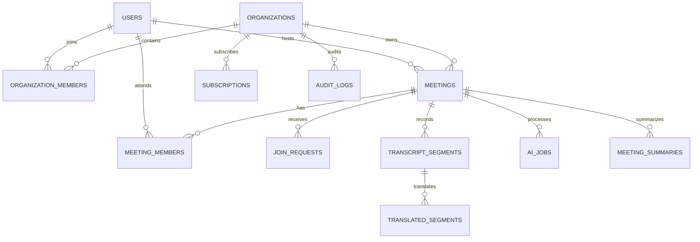

# AuraClave — Database Design

## 1. Principles

- PostgreSQL is the durable system of record.
- Use UUID primary keys, UTC timestamps, foreign keys, unique constraints, and explicit status enums/check constraints.
- Every tenant-owned record must have an `organization_id` or a provable relationship to one.
- Enforce authorization in application services; row-level security (RLS) is defense-in-depth, not a replacement.
- Use migrations with forward and rollback plans.
- Store secrets as hashes or in a secret manager; never store raw invitation/reset tokens.
- Keep large media objects in object storage, not PostgreSQL.
- Store transcript and translation content only under explicit retention and consent policy.

## 2. Logical entity groups

### Identity and organizations

| Table | Important columns | Constraints / notes |
|---|---|---|
| `users` | `id`, `email`, `display_name`, `avatar_url`, `status`, timestamps | Normalized unique email; status active/suspended/deleted |
| `user_preferences` | `user_id`, `preferred_language`, `timezone`, `settings_json` | One-to-one with user |
| `organizations` | `id`, `name`, `slug`, `plan_id`, `status` | Unique normalized slug |
| `organization_members` | `id`, `organization_id`, `user_id`, `role_id`, `status` | Unique org/user pair |
| `teams` | `id`, `organization_id`, `name` | Tenant-scoped |
| `team_members` | `team_id`, `user_id`, `role` | Composite unique key |
| `invitations` | `id`, `organization_id`, `email`, `role_id`, `token_hash`, `expires_at`, `accepted_at` | Store token hash only |
| `roles` | `id`, `scope`, `key`, `name` | System and tenant role scopes |
| `permissions` | `id`, `key`, `description` | Stable permission key |
| `role_permissions` | `role_id`, `permission_id` | Composite primary key |

### Meetings and admission

| Table | Important columns | Constraints / notes |
|---|---|---|
| `meetings` | `id`, `organization_id`, `host_user_id`, `title`, `status`, `scheduled_at`, `started_at`, `ended_at` | Organization nullable only for explicitly supported personal meetings |
| `meeting_settings` | `meeting_id`, `waiting_room_enabled`, `guest_policy`, `recording_policy`, `transcription_policy` | One row per meeting |
| `meeting_members` | `id`, `meeting_id`, `user_id`, `role`, `joined_at`, `left_at` | Unique active membership policy; role server-owned |
| `meeting_guests` | `id`, `meeting_id`, `display_name`, `email`, `invite_token_hash`, `status`, `expires_at` | Guest authorization is explicit and expiring |
| `join_requests` | `id`, `meeting_id`, `user_id` or `guest_id`, `status`, `requested_at`, `decided_by`, `decided_at` | State transition audit |
| `meeting_events` | `id`, `meeting_id`, `actor_id`, `event_type`, `payload_json`, `created_at` | Append-only event/audit trail; payload allowlisted |
| `meeting_integrations` | `id`, `meeting_id`, `provider`, `external_id`, `status` | Provider identifiers |

### Speech and translation

| Table | Important columns | Constraints / notes |
|---|---|---|
| `speech_sessions` | `id`, `meeting_id`, `speaker_user_id`, `provider`, `provider_session_id`, `status`, timestamps | No raw provider secrets |
| `transcript_segments` | `id`, `meeting_id`, `speaker_user_id`, `sequence_number`, `source_language`, `text`, `start_time_ms`, `end_time_ms`, `status` | Unique meeting/speaker/sequence; status interim/final |
| `translated_segments` | `id`, `transcript_segment_id`, `target_language`, `translated_text`, `provider`, `status`, `created_at` | Unique segment/target language/version policy |
| `participant_languages` | `meeting_id`, `user_id`, `target_language`, `caption_mode` | One preference per participant/meeting |
| `translation_glossaries` | `id`, `organization_id`, `name`, `created_by` | Tenant-scoped |
| `glossary_terms` | `id`, `glossary_id`, `source_term`, `target_term`, `source_language`, `target_language` | Unique glossary/source/target pair |
| `translation_feedback` | `id`, `translated_segment_id`, `user_id`, `rating`, `correction`, `created_at` | Feedback access limited to meeting participants |

### AI and workspace

| Table | Important columns | Constraints / notes |
|---|---|---|
| `ai_jobs` | `id`, `meeting_id`, `job_type`, `status`, `provider`, `model`, `attempt_count`, `error_code` | Idempotency key; retry metadata |
| `meeting_summaries` | `id`, `meeting_id`, `language`, `summary_json`, `provider`, `model`, `schema_version` | Versioned output |
| `meeting_decisions` | `id`, `meeting_id`, `description`, `evidence_segment_ids` | Evidence references validated |
| `action_items` | `id`, `meeting_id`, `description`, `owner_user_id`, `due_date`, `status`, `evidence_segment_ids` | Owner may be null when uncertain |
| `meeting_questions` | `id`, `meeting_id`, `question`, `answer`, `source_segment_ids`, `created_by` | Authorized access only |
| `workspace_documents` | `id`, `organization_id`, `owner_id`, `title`, `storage_key`, `status` | Object storage key, not public URL |
| `workspace_notes` | `id`, `organization_id`, `meeting_id`, `author_id`, `content` | Access policy by tenant/meeting |
| `tasks` | `id`, `organization_id`, `title`, `assignee_id`, `status`, `due_date` | Tenant-scoped |
| `recordings` | `id`, `meeting_id`, `storage_key`, `recording_type`, `retention_until`, `status` | Encrypted object; consent and retention checks |
| `exports` | `id`, `user_id`, `meeting_id`, `file_type`, `storage_key`, `expires_at`, `status` | Short-lived download links |
| `notifications` | `id`, `user_id`, `type`, `status`, `payload_json`, timestamps | Avoid sensitive content in push payload |

### Billing and compliance

| Table | Important columns | Constraints / notes |
|---|---|---|
| `plans` | `id`, `key`, `name`, `billing_interval`, `status` | Plan catalogue |
| `plan_entitlements` | `id`, `plan_id`, `feature_key`, `limit_value` | Unique plan/feature |
| `subscriptions` | `id`, `organization_id`, `plan_id`, `provider`, `provider_subscription_id`, `status` | Unique provider subscription |
| `usage_records` | `id`, `organization_id`, `meeting_id`, `metric`, `quantity`, `unit`, `occurred_at`, `idempotency_key` | Server-generated and deduplicated |
| `usage_aggregates` | `id`, `organization_id`, `period_start`, `period_end`, `metric`, `total` | Unique org/period/metric |
| `invoices` | `id`, `organization_id`, `provider_invoice_id`, `amount_minor`, `currency`, `status` | Amount in minor units |
| `payment_events` | `id`, `provider`, `provider_event_id`, `event_type`, `processed_at` | Unique provider/event ID |
| `audit_logs` | `id`, `organization_id`, `actor_id`, `action`, `resource_type`, `resource_id`, `metadata_json`, `created_at` | Append-only, restricted access |
| `security_events` | `id`, `organization_id`, `user_id`, `event_type`, `severity`, `created_at` | Security monitoring |
| `consent_records` | `id`, `meeting_id`, `user_id`, `consent_type`, `granted_at`, `revoked_at` | Immutable event history |
| `retention_policies` | `id`, `organization_id`, `resource_type`, `retention_days`, `enabled` | Tenant policy bounded by legal/product minimums |
| `data_deletion_jobs` | `id`, `user_id`, `organization_id`, `status`, `requested_at`, `completed_at` | Track downstream deletion |

## 3. Important relationships

## 4. State machines

### Meeting lifecycle
`scheduled → live → ended`  
Additional terminal/exception states: `cancelled`, `failed`.

Only authorized host/admin actions may start, end, or cancel a meeting. Lifecycle transitions must be transactional and idempotent.

### Admission lifecycle
`requested → admitted | rejected | expired | cancelled`

A pending or rejected participant must not receive a LiveKit token. Re-admission after rejection requires a new authorized decision; stale client state cannot override the server.

### Transcript lifecycle
`interim → final`  
Optional error state: `failed`.

A final segment is immutable in sequence identity. Corrections should be stored as a separate revision or correction record, not silently overwrite the original evidence.

### AI job lifecycle
`queued → running → succeeded | failed | cancelled`

Retries must use idempotency keys and bounded backoff. Permanent provider/schema errors should not retry indefinitely.

## 5. Indexing and partitioning guidance

Initial indexes:
- `users(lower(email))` unique.
- `organization_members(organization_id, user_id)` unique.
- `meetings(organization_id, status, scheduled_at)`.
- `meeting_members(meeting_id, user_id)`.
- `join_requests(meeting_id, status, requested_at)`.
- `transcript_segments(meeting_id, speaker_user_id, sequence_number)` unique.
- `translated_segments(transcript_segment_id, target_language)` unique.
- `ai_jobs(status, created_at)`.
- `usage_records(organization_id, occurred_at, metric)`.
- `audit_logs(organization_id, created_at)`.

Do not partition prematurely. Measure transcript volume and retention first. If needed, partition high-volume transcript/event/usage tables by time or tenant-aware strategy while preserving FK and query semantics.

## 6. Tenant isolation

- Every query must be scoped using a verified tenant context.
- Never accept `organization_id` from a client without checking membership and permissions.
- Use composite constraints where they prevent cross-tenant references.
- Consider PostgreSQL RLS policies for tenant-owned tables.
- Use separate DB roles for migrations and runtime.
- Test cross-tenant access with adversarial integration tests.
- Ensure background jobs re-check tenant and resource authorization before processing or delivering results.

## 7. Migration strategy from current persistence

1. Inventory all reads/writes to `backend/data/users.json`, in-memory room maps, and any other local persistence.
2. Define schema and migration scripts.
3. Provision PostgreSQL in staging and configure backups.
4. Build repositories behind interfaces while preserving current API contracts.
5. Import users with stable IDs and password hashes; validate row counts and uniqueness.
6. Introduce dual-read/controlled migration only if necessary; avoid uncontrolled dual-write.
7. Migrate meeting and admission state with explicit lifecycle semantics.
8. Run parity checks and security tests.
9. Switch authoritative reads/writes to PostgreSQL.
10. Retain a tested rollback/restore plan; remove legacy persistence only after verified cutover.

Never log password hashes, raw invitation tokens, session tokens, transcript content, or recording URLs during migration.

## 8. Data retention and deletion

Define retention by data category:
- Account/profile.
- Meeting metadata.
- Transcript and translations.
- AI summaries/action items.
- Recordings.
- Exports.
- Audit/security records.
- Billing/tax records.

Deletion must cover primary DB, object storage, derived exports, caches, search indexes, and queued jobs where applicable. Some legal/accounting records may require retention; document the basis and minimize retained personal content. Provide deletion job status and audit evidence.

## 9. Open decisions before schema freeze

- Is every meeting owned by an organization, or can users create personal meetings?
- Which identity provider is authoritative?
- Are guests email-based, anonymous, or both?
- Which transcript retention defaults apply to Free/Business/Enterprise?
- Is recording a separate consent from transcription?
- Are captions stored by default or only when meeting policy permits?
- Which payment providers are available for target merchant jurisdictions?
- What is the expected transcript volume and retention window?
