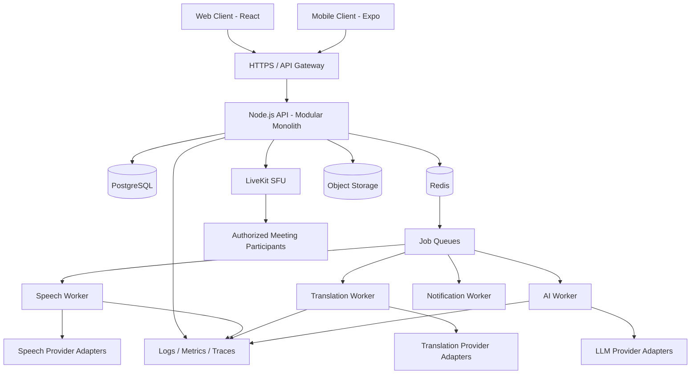

# AuraClave — Target Architecture

## 1. Product and architecture decisions

| Decision | Selection |
|---|---|
| Product | Enterprise collaboration and communication platform |
| Differentiator | Participant-specific multilingual communication + meeting intelligence |
| Markets | India and global |
| Launch | Public launch after production hardening |
| Backend shape | Modular monolith |
| Scale-out | Independently deployable workers for CPU/network/provider-heavy jobs |
| Media | LiveKit SFU |
| Durable system of record | PostgreSQL |
| Ephemeral coordination | Redis |
| Object storage | S3-compatible storage |
| API | Versioned REST + authenticated realtime channels |

Do not start with microservices. The modular monolith keeps transactions and development manageable while worker processes isolate speech, translation, AI, and notifications.

## 2. Logical architecture



## 3. Deployment topology

### Core API
- Stateless Node.js/TypeScript API instances.
- Authentication middleware, tenant context, authorization policy engine.
- REST `/api/v1`.
- WebSocket/SSE only where persistent event delivery is needed.
- PostgreSQL transactions for durable state.
- Redis for rate limiting, ephemeral presence, locks, cache, and queue transport.

### Independent workers
- `speech-worker`: manages provider streaming sessions and ASR.
- `translation-worker`: language routing, glossary/context, translation provider calls, caching.
- `ai-worker`: summaries, decisions, action items, meeting Q&A.
- `notification-worker`: email, push, reminders, invitations.

Workers must be idempotent, observable, restartable, and safe under duplicate job delivery.

### Real-time media
- LiveKit handles media transport and SFU functions.
- API issues short-lived LiveKit tokens only after authorization.
- LiveKit webhooks update backend state after signature verification and replay protection.
- Never use a room name or client-side role flag as sufficient authorization.

### Storage
- PostgreSQL: identity, organizations, meetings, participants, admission, transcripts metadata, translations, AI artifacts, billing, audit, consent.
- Redis: presence, transient coordination, throttling, job queue.
- Object storage: recordings and generated exports, encrypted with lifecycle policies.
- Secrets: managed secret store, not committed files or client bundles.

## 4. Module boundaries

| Module | Owns | Must not own |
|---|---|---|
| Identity | Accounts, sessions, verification, recovery, MFA | Meeting admission decisions |
| Organization | Tenants, memberships, teams, invitations, policies | RTC provider tokens |
| Authorization | Policy evaluation, tenant scoping, permission checks | UI-only role state |
| Meeting | Meeting lifecycle, settings, schedule, ownership | Raw media transport |
| Admission | Join requests, guest access, waiting room state | Client-trusted admission |
| RTC | LiveKit tokens, webhooks, provider lifecycle | Product identity records |
| Speech | Audio session orchestration, ASR segments | Organization membership authority |
| Translation | Language preferences, glossary, translation jobs | Speech source-of-truth |
| Intelligence | Summaries, decisions, tasks, Q&A | Unscoped transcript retrieval |
| Workspace | Shared docs, notes, tasks, meeting library | Billing entitlement calculation |
| Billing | Plans, entitlements, usage, payments | Client-reported authoritative usage |
| Notification | Email, push, reminders | Authentication decisions |
| Audit & compliance | Audit, consent, retention, deletion jobs | Untracked destructive operations |

Each module exposes application services and typed contracts. Cross-module access should go through service interfaces, not direct ad-hoc table manipulation.

## 5. Core request flows

### 5.1 Authenticated meeting join
1. Client authenticates with the identity service.
2. Client requests `POST /api/v1/meetings/{meetingId}/join`.
3. API verifies account status and session.
4. API loads meeting and tenant context.
5. Authorization checks organization membership, guest invitation, meeting status, and access policy.
6. Admission service evaluates waiting-room state.
7. If pending, return a pending state and do not issue a LiveKit token.
8. If admitted, create/update participant state transactionally.
9. RTC service issues a short-lived token with minimum necessary grants.
10. Client connects to LiveKit.
11. Verified LiveKit webhooks update presence/lifecycle.

### 5.2 Multilingual captions
1. Participant audio reaches LiveKit.
2. Authorized server-side media integration routes audio to a speech session.
3. VAD/chunking feeds the selected streaming ASR provider.
4. ASR emits interim and final transcript segments with stable sequence numbers.
5. Final segment is persisted according to tenant retention policy.
6. Translation orchestrator determines distinct target languages among active participants.
7. Translate once per target language per source segment, using glossary/context and tenant-scoped cache.
8. Publish caption events with original and translated text, speaker attribution, timestamps, and sequence.
9. Client renders original/translated/bilingual mode based on preference.
10. Provider failures are surfaced as degraded state; retries must not duplicate final captions.

**Important:** Browser Web Speech API can be retained as an optional local fallback. It is not the only production ASR path.

### 5.3 AI meeting intelligence
1. Meeting ends or an authorized user requests a summary.
2. API creates an AI job and returns job ID.
3. Worker loads only transcript segments authorized for that meeting and tenant.
4. Worker calls a provider adapter with bounded context.
5. Output is schema-validated and stored with model/provider/version.
6. Decisions and action items reference evidence segment IDs.
7. UI presents results for human review.
8. “Ask this meeting” retrieves authorized evidence and returns source references/timestamps.

## 6. Translation contracts

### Provider interfaces

```ts
export interface SpeechProvider {
  connect(config: SpeechConfig): Promise<SpeechSession>;
  sendAudio(session: SpeechSession, chunk: AudioChunk): Promise<void>;
  close(session: SpeechSession): Promise<void>;
}

export interface TranslationProvider {
  translate(input: TranslationInput): Promise<TranslationResult>;
}

export interface AIProvider {
  generate(input: AIRequest): Promise<AIResponse>;
}
```

### Caption event

```ts
type CaptionEventV1 = {
  schemaVersion: 1;
  eventId: string;
  meetingId: string;
  speakerId: string;
  sequenceNumber: number;
  sourceLanguage: string;
  targetLanguage?: string;
  originalText: string;
  translatedText?: string;
  startTimeMs: number;
  endTimeMs: number;
  status: "interim" | "final";
  provider: string;
  createdAt: string;
};
```

Validate payload schema, maximum text length, meeting membership, sender identity, sequence progression, and deduplication. Do not treat a client-provided `speakerId` as proof of identity.

## 7. Data and event ownership

- PostgreSQL is authoritative for durable meeting, membership, admission, transcript, translation, AI, billing, and audit records.
- Redis is not the only copy of any security-critical decision.
- LiveKit is authoritative for media transport state, but not tenant membership or product permissions.
- Queue messages contain IDs and versioned metadata; workers reload authoritative records.
- All jobs carry idempotency keys and correlation IDs.

## 8. API conventions

- Prefix: `/api/v1`.
- JSON request/response validation using a shared schema library.
- Consistent error envelope with stable machine-readable codes.
- Pagination for list endpoints.
- UTC timestamps in ISO 8601.
- Idempotency keys for payment, job creation, and other retry-sensitive operations.
- OpenAPI contract generated and checked in CI.
- Rate limits per account, tenant, IP, and sensitive action.

Key endpoints:
- Auth: `/auth/register`, `/auth/login`, `/auth/logout`, `/auth/refresh`, `/auth/me`.
- Organizations: `/organizations`, `/organizations/{id}/members`, `/invitations`.
- Meetings: `/meetings`, `/meetings/{id}`, `/meetings/{id}/join`, `/meetings/{id}/leave`.
- Admission: `/meetings/{id}/join-requests`, `/meetings/{id}/admission`.
- RTC: `/meetings/{id}/rtc-token`, `/webhooks/livekit`.
- Captions: `/meetings/{id}/captions/preferences`, `/transcripts`, `/translation-feedback`.
- AI: `/meetings/{id}/summary`, `/action-items`, `/questions`.
- Billing: `/billing/plans`, `/billing/subscription`, `/billing/usage`, provider webhook endpoints.

## 9. Observability and reliability

Every request/job/event should carry:
- `requestId` / `correlationId`
- tenant ID where applicable
- meeting ID where applicable
- actor ID (not secrets)
- provider and model metadata
- latency and outcome

Track API latency/error rate, DB pool health, queue depth/age, worker failures, provider rate limits/timeouts, meeting join success, reconnects, ASR/translation latency, caption delivery, and usage cost.

Do not log raw audio, access tokens, passwords, or full transcript content by default. Sensitive diagnostic capture requires explicit policy and redaction.

## 10. Architecture decision records

### ADR-001: Modular monolith first
**Decision:** One modular API codebase with independent worker processes.  
**Reason:** Lower operational overhead and simpler transactions while preserving future extraction paths.  
**Revisit when:** A module needs independent scaling, deployment cadence, security boundary, or team ownership.

### ADR-002: PostgreSQL as system of record
**Decision:** PostgreSQL owns durable product state.  
**Reason:** Transactions, constraints, relational tenant boundaries, backups, and operational maturity.  
**Revisit when:** A concrete workload demonstrates a specialized storage need.

### ADR-003: LiveKit for media transport
**Decision:** Retain LiveKit as the media/SFU layer.  
**Reason:** Avoid rebuilding media infrastructure; keep product authorization in AuraClave.

### ADR-004: Provider adapters for speech and translation
**Decision:** No provider-specific business logic in UI or domain modules.  
**Reason:** Benchmark providers and switch/fail over without redesigning product contracts.

### ADR-005: Translation-first product differentiation
**Decision:** Prioritize accurate participant-specific multilingual captions before expanding secondary AI features.  
**Reason:** It is the strongest product differentiator and a prerequisite for trustworthy multilingual meeting intelligence.
