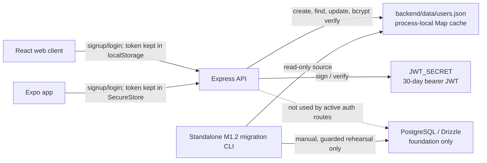
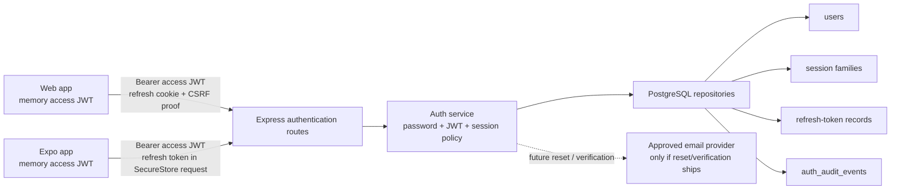
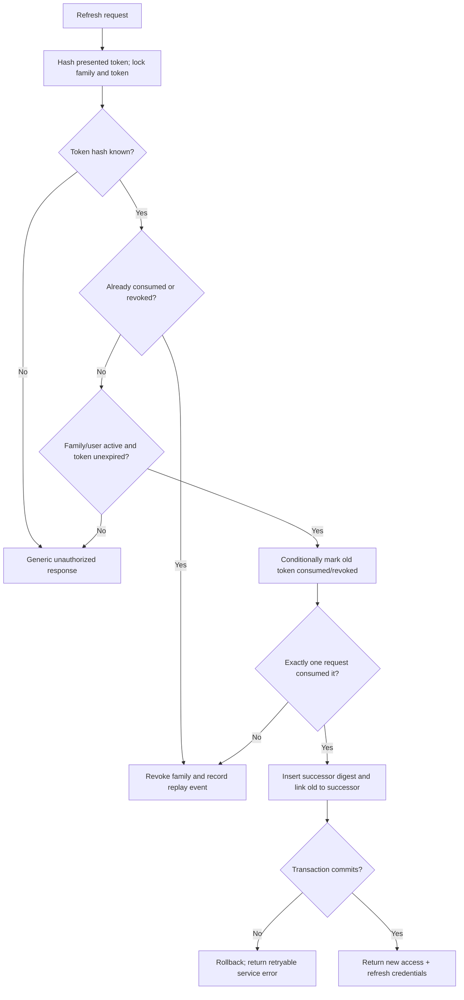
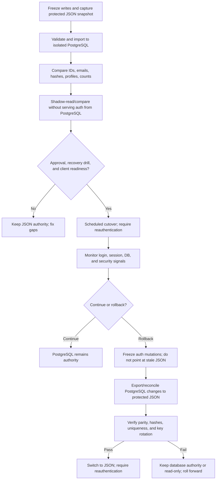

# M1.3 - Authentication Migration Design & Compatibility Planning

**Status:** Design for review; no authentication implementation or cutover authorized
**Repository state reviewed:** `feature/milestone-1-foundation` at `5e38fe0076caeb2a536e1a60925c92111a97bd8b`
**Design boundary:** JSON-backed authentication remains active. This document proposes future work only; it does not change application behavior, schema, or migration state.

## Evidence labels

- **Verified current behavior** means it was observed in the checked-in source or the current working tree during this review.
- **Proposed target** means a design recommendation, not implemented functionality.
- **Assumption** means a point to confirm before implementation.
- **Approval required** means a product/security/operations decision must be recorded before the dependent stage.

No email addresses, user IDs, password hashes, tokens, credentials, or environment values have been copied into this document.

## 1. Executive summary

AuraClave currently authenticates through a small Express API and a JSON user file. Signup and login return a 30-day signed JWT. Passwords are bcrypt hashes. The web client stores the bearer token in `localStorage`; the shipped Expo app stores its bearer token in Expo SecureStore. Logout is local client cleanup, not server-side revocation. There is no active refresh-token flow, email-verification flow, or password-reset flow in the inspected Express routes.

The PostgreSQL/Drizzle schema and repositories are a foundation, not the live authentication authority. `server.ts` imports JSON persistence from `db.ts`; it does not import the PostgreSQL identity repository. The M1.2 migration utility is separate from API traffic and is intentionally limited to loopback databases whose names contain `test` or `disposable`.

**Proposed target:** preserve user UUIDs and bcrypt hashes; introduce an algorithm-aware password verifier that can accept bcrypt and Argon2id; upgrade a bcrypt hash only after successful password verification; issue short-lived JWT access tokens; and use opaque, rotating, hashed refresh tokens in server-side session families. Web and mobile clients need different refresh-token transport/storage while retaining the existing user and product APIs where practical.

The migration must be staged, measured, and reversible. Existing 30-day JWTs are stateless and cannot be converted into refresh-token sessions. The safest cutover is an announced reauthentication boundary: legacy tokens stop being accepted by the new verifier, and users sign in again to create managed sessions. A rollback must not point at a stale JSON snapshot after PostgreSQL identity writes have occurred; it requires a tested reverse reconciliation or a decision to roll forward.

## 2. Current-state architecture

### 2.1 Verified architecture



### 2.2 Backend findings

| Area | Verified current behavior and source | Migration implication |
|---|---|---|
| JSON identity store | [`backend/src/db.ts`](../../backend/src/db.ts): `UserRecord`, `ensureDb`, `persist`, `findUserByEmail`, `findUserById`, `createUser`, `updateUserProfile`, `verifyPassword`. The file is parsed into a process-local `Map`; writes use a temporary file followed by rename. New IDs are created with `crypto.randomUUID()`. The map is keyed by `email.toLowerCase()`. Lookups and new signup use `trim().toLowerCase()`, while pre-existing source email values are not rewritten when loaded. | The JSON store is not a multi-process transactional database. Signup/profile writes can race across API processes, and a process-local cache can become stale. Before a final snapshot, identity writes must be quiesced. Validate and reconcile email normalization; do not assume the runtime map has enforced target uniqueness. |
| Current source data | At this inspection `backend/data/users.json` was an array with one record. The field set was `id`, `email`, `passwordHash`, `fullName`, `createdAt`; the UUID was valid, the observed hash format was bcrypt `$2b$` cost 10, email was already normalized, and `avatarUrl` was absent. Only these structural facts are recorded; values are intentionally omitted. | This is a point-in-time observation, not an import count guarantee. Recount and validate a protected snapshot at migration time. Existing user UUIDs must be preserved. |
| Signup | [`backend/src/server.ts`](../../backend/src/server.ts), `POST /api/auth/signup`: validates an email using a basic `includes("@")` check and requires a password of at least six characters; calls JSON `createUser`; returns `{ user, token }` with HTTP 201. Duplicate email errors are returned to the caller. | Preserve the current response shape during a compatibility stage. Improve validation and enumeration behavior separately, with UI and API tests. Do not mark legacy accounts verified unless evidence exists. |
| Password creation and verification | [`backend/src/db.ts`](../../backend/src/db.ts): `createUser` uses `bcrypt.genSalt(10)` and `bcrypt.hash`; `verifyPassword` uses `bcrypt.compare`. The current function does not explicitly dispatch on an encoded hash algorithm. | New Argon2id hashes require an algorithm-aware verifier before any new Argon2id hashes are written. Keep legacy bcrypt readable. Never bulk-rehash or rewrite a hash without successful verification of the user's password. |
| Login | [`backend/src/server.ts`](../../backend/src/server.ts), `POST /api/auth/login`: looks up the JSON record, verifies the bcrypt hash, and returns `{ user, token }`. Missing user and wrong password share the response text "Invalid email or password." and HTTP 400. There is no rate-limit middleware in the inspected server/package configuration. | Preserve generic credential errors. Add account/IP throttling and abuse monitoring without revealing whether an email exists. |
| JWT creation | [`backend/src/auth.ts`](../../backend/src/auth.ts), `generateToken`: signs custom `id`, `email`, and `fullName` claims using `JWT_SECRET`; `expiresIn` is `"30d"`. `jsonwebtoken` defaults to HS256 for this signing call; the code does not specify issuer, audience, key ID, or an algorithm allowlist for verification. | Existing tokens are long-lived and do not identify a server-side session. Define a distinct new token profile and explicit verification requirements; do not assume the current token meets the proposed access-token contract. |
| Authentication lookup | [`backend/src/auth.ts`](../../backend/src/auth.ts), `getAuthenticatedUser`: accepts a Bearer header, calls `jwt.verify`, then looks up the user in JSON. If that user is absent, it falls back to email/name claims in the token. The verified payload is cast to a TypeScript shape rather than validated against an application claim schema. Errors are normalized to an invalid/expired-session message. | A database-backed verifier must not silently fall back to stale JWT claims or the JSON store. Select exactly one identity authority per deployment mode and fail closed on invalid claims. |
| Profile | [`backend/src/server.ts`](../../backend/src/server.ts), `PATCH /api/auth/profile`: updates JSON profile fields and issues a new 30-day token. The web client applies a local profile override optimistically and may retain it when backend sync fails. | Keep current profile and meeting payload shapes compatible. Define the authoritative update and token refresh semantics before switching repositories. |
| Current-user endpoint | `GET /api/auth/me` in [`backend/src/server.ts`](../../backend/src/server.ts) returns `{ user }` after Bearer authentication. | This is the existing session-restoration contract used by both clients. Preserve or version it deliberately. |
| Logout, refresh, reset, verification | The inspected auth routes in `server.ts` include signup, login, profile, and `/me`; there are no active logout, refresh, password-reset, or email-verification routes. The JSON `UserRecord` has no status, verification, reset-token, session, or refresh-token fields. | Do not claim these features are currently available. Adding them is an API and client change and needs email-provider, policy, and UX decisions. |
| Environment and database use | [`backend/src/lib/env.ts`](../../backend/src/lib/env.ts) and `assertAuthConfig` require a non-empty `JWT_SECRET`; no minimum entropy/length is enforced in these checks. [`backend/src/database/client.ts`](../../backend/src/database/client.ts) creates its pool lazily through `getDatabase`. The active server imports `db.ts`, not the PostgreSQL repository. | Keep `DATABASE_URL` optional for JSON-mode startup. Add target signing-key validation without accidentally making database availability a prerequisite before the approved cutover. |
| PostgreSQL repository | [`backend/src/repositories/postgres-identity-repository.ts`](../../backend/src/repositories/postgres-identity-repository.ts) has identity/token/session CRUD helpers, including create/find/revoke and family revocation. It does not implement a complete refresh rotation, reuse detection, session listing, or a single transaction covering rotation and audit. | Extend repository operations transactionally before use. Existing helper methods are not sufficient evidence that the target lifecycle is implemented. |
| Migration utility | [`backend/src/scripts/migrate-json-identities.ts`](../../backend/src/scripts/migrate-json-identities.ts) is a standalone CLI; it is not imported by the active server. It defaults to dry-run, requires an explicit confirmation for writes, rejects production mode, and accepts only loopback PostgreSQL URLs whose database name contains `test` or `disposable`. [`backend/src/migrations/json-identity-migration.ts`](../../backend/src/migrations/json-identity-migration.ts) currently validates bcrypt-format hashes and preserves them. | The current utility is only for local disposable rehearsal; it cannot target shared staging or production. A future approved operational migration path must be separately reviewed and gated. If Argon2id hashes are introduced before migration, the validator/mapping must be extended first. |
| Tests | `backend/tests` currently contains health, environment, database configuration, PostgreSQL integration, and JSON migration tests; it contains no dedicated active-auth route/JWT/password compatibility suite. | Add focused auth tests before changing runtime behavior. The two database integration cases are not a substitute for API, session lifecycle, or browser/mobile tests. |

### 2.3 Web findings

| Area | Verified current behavior and source | Migration implication |
|---|---|---|
| Auth client | [`nexmeet/src/lib/auth.ts`](../../nexmeet/src/lib/auth.ts): `signUp`, `signIn`, `verifySession`, `signOut`, and `updateProfile` call the existing `/api/auth/*` routes using `fetch`. The API returns a `token`, exposed through the client's `AuthSession.access_token` shape. | Avoid breaking current consumers. Migrate client and server contracts in coordinated, testable stages. |
| Token persistence | The web client stores the bearer token, cached user, and profile override in `localStorage`. Other product code also reads the token directly, including [`nexmeet/src/lib/auraweave.ts`](../../nexmeet/src/lib/auraweave.ts) and [`nexmeet/src/components/AuraWeaveConference.tsx`](../../nexmeet/src/components/AuraWeaveConference.tsx). | Remove long-lived token storage from `localStorage` only after all direct consumers are audited and changed to a shared in-memory access-token provider. Cached non-secret profile data is a separate decision. |
| Session restore and routes | [`nexmeet/src/contexts/AuthContext.tsx`](../../nexmeet/src/contexts/AuthContext.tsx) restores cached state and calls `/api/auth/me`; [`nexmeet/src/components/Protected.tsx`](../../nexmeet/src/components/Protected.tsx) gates the dashboard and meeting routes. On a network error, `verifySession` may return the cached user, so the UI can remain signed in while protected API calls fail. | Distinguish invalid/expired sessions from network outages. Do not erase a valid refresh credential on transient network failure; show an offline/retry state. |
| CORS/deployment | [`backend/src/server.ts`](../../backend/src/server.ts) configures `cors({ origin: true, credentials: true })`. [`nexmeet/src/lib/auth.ts`](../../nexmeet/src/lib/auth.ts) documents a separately hosted Firebase frontend and Render API fallback. | Cookie authentication requires an explicit origin allowlist and deliberate cookie-site design. Current cross-site hosting can require `SameSite=None; Secure` and may be affected by browser third-party-cookie restrictions. Prefer app/API hostnames under a shared site before relying on cross-site cookies. |
| Error handling | Login/signup failures surface API messages in the auth page; session validation signs out on non-OK responses but returns cached user on fetch failure. Profile updates can fall back to locally retained profile data. | Keep errors useful without leaking identity existence or database details. New refresh failures need distinct unauthorized, unavailable, and retryable outcomes. |

### 2.4 Mobile findings

The repository has two Expo-related trees; they are not equivalent:

- **Integrated app:** [`mobile/App.tsx`](../../mobile/App.tsx), entered from [`mobile/index.ts`](../../mobile/index.ts). It implements login/signup against the same `/api/auth/login` and `/api/auth/signup`, stores the access token and cached user with `expo-secure-store`, restores via `/api/auth/me`, and passes the bearer token to the LiveKit-token API. Sign-out deletes local SecureStore values; there is no server revocation call. Any `/me` failure clears the stored token and user, including transient network failures.
- **Scaffold app:** [`mobile/auraclave/src/app/index.tsx`](../../mobile/auraclave/src/app/index.tsx) and `_layout.tsx` show the default Expo starter navigation/screens, not an AuraClave authentication implementation. Do not assume it participates in auth migration.

The integrated mobile app currently persists its 30-day access JWT in SecureStore. The proposed design changes this to a short-lived access token in memory and a rotating refresh token in SecureStore; this requires an explicit app upgrade and reauthentication/refresh transition.

## 3. Target authentication architecture

### 3.1 Proposed target

Keep the existing Express monolith and product APIs. Introduce a small authentication service boundary around password verification, identity persistence, token issuance, and session operations. Keep HTTP route handlers thin and preserve existing user object fields unless an additive API version is approved.



**Authority invariant:** in a given deployment mode, the active auth service has one identity authority. Do not perform per-request JSON-to-PostgreSQL fallback, hidden dual-write, or "user not found" fallback between stores; those paths can resurrect deleted accounts or accept stale claims.

## 4. Password migration strategy

### 4.1 Hash selection and verification

**Proposed target:**

1. Treat encoded hash prefixes as an algorithm identifier, then validate the full encoded format and bounded parameters before invoking a verifier:
   - bcrypt: `$2a$`, `$2b$`, and `$2y$` only where compatibility tests prove the chosen library accepts that prefix correctly.
   - Argon2id: `$argon2id$` with supported version/parameters and configured resource bounds.
2. Verify only with the identified algorithm. Do not try algorithms indiscriminately, reinterpret malformed hashes, or fall back to plaintext.
3. Unsupported/malformed hashes fail closed. Return the same generic login failure to the client and emit only a safe operational event keyed by a non-secret identifier; never log the hash or submitted password.
4. Once every active verifier and the migration validator support both formats, write Argon2id hashes for newly created/changed passwords. Until that compatibility gate is met, keep the current JSON bcrypt writer active; do not introduce a hash that another running instance cannot verify.
5. Preserve every legacy hash byte-for-byte during identity import. Do not reset, rehash, or normalize an existing hash as part of bulk migration.
6. After a successful bcrypt verification, upgrade that user's hash to Argon2id by default when the selected identity store can perform a safe compare-and-swap update conditioned on user ID and the exact prior hash. If a safe conditional update is unavailable, allow the verified login but leave the hash unchanged and emit a safe upgrade-failure metric; never treat an upgrade failure as invalid credentials.
7. Never persist plaintext or reversible password material.

The current observed source has one bcrypt `$2b$` cost-10 hash. The current `verifyPassword` function delegates to `bcrypt.compare`; there is no Argon2 dependency or hash dispatcher. M1.2 migration validation currently accepts bcrypt encodings only. If M1.4 introduces Argon2id hashes in JSON mode before data migration, update and test the M1.2 validator before such hashes can be written.

### 4.2 Argon2id parameters

**Proposed starting baseline:** Argon2id version 19, memory 19 MiB (`m=19456 KiB`), time cost 2, parallelism 1, using a unique random salt generated by the library. This is a conservative interoperability/security baseline; benchmark on the actual production CPU and memory limits before release. If the measured verification time is materially below the service's latency budget, raise memory/time cost. Do not select parameters by development-laptop speed alone.

Bound accepted hash parameters during verification to prevent attacker-controlled encoded values from causing excessive CPU/memory use after a database compromise. Limit concurrent Argon2 operations with a bounded worker/semaphore and monitor queue time; memory-hard hashing trades brute-force cost for per-request resource pressure. Parameter changes apply to new hashes and successful upgrades; existing bcrypt hashes remain valid until successfully upgraded or changed by the account owner.

**Approval required:** production parameter target, p95/p99 latency budget, and maximum concurrent hash workers.

## 5. Access-token architecture

### 5.1 Proposed access JWT contract

Issue an access token with a 10-15 minute lifetime; use 10 minutes initially unless measured client/network constraints justify 15. Proposed claims:

| Claim | Meaning |
|---|---|
| `sub` | Stable AuraClave user UUID. |
| `iss` | Exact configured AuraClave issuer identifier. |
| `aud` | Explicit API audience; reject tokens for other services. |
| `iat`, `exp` | Issued-at and short expiry; enforce a small bounded clock tolerance. |
| `jti` | Unique token identifier for audit/correlation; do not log bearer material. |
| `sid` | Stable session-family UUID, used to enforce server-side revocation/status. |
| `typ` | Explicit access-token purpose, e.g. `access`; reject refresh or unrelated tokens. |

Do not include password data, refresh tokens, unnecessary profile fields, or long-lived authorization state. Existing `id`, `email`, and `fullName` claims are not a substitute for a validated subject/session contract. Resolve current profile from PostgreSQL when the API requires it.

### 5.2 Signing and validation

**Proposed target:** RS256 signing with a private key held in a managed secret store/KMS and public verification material available to the API. This avoids distributing signing capability to consumers. Pin the accepted algorithm in verification; require the configured issuer, audience, token type, subject UUID, session ID, and valid `iat`/`exp`. Reject `none`, unexpected algorithms, malformed claims, future-issued tokens outside allowed skew, and expired tokens.

Use a `kid` header to select a key from an explicit allowlist. Rotation procedure:

1. Publish new public key to all verifiers.
2. Begin signing with the new private key and `kid`.
3. Continue verifying the prior public key only for the maximum access-token lifetime plus clock skew.
4. Remove the old verifier key and securely retire the old private key.
5. For compromise, revoke the compromised key immediately, invalidate tokens signed by it, and require affected users to reauthenticate; do not wait for normal expiry.

**Assumptions/approval:** one API currently issues AuraClave JWTs, but downstream JWT consumers beyond this repository must be inventoried. Confirm whether managed asymmetric key support is available in the deployment platform; otherwise approve an alternative with equivalent key isolation and rotation controls.

### 5.3 Revocation limits

Stateless JWTs cannot be recalled by deleting a client token. The proposed `sid` session-family check lets authenticated API middleware reject tokens whose family is revoked or expired; this costs a database lookup or a carefully bounded cache on protected requests. Start without a cache to preserve immediate logout/revocation semantics. If caching is later introduced, document the maximum revocation delay.

If PostgreSQL is unavailable after cutover, fail closed for protected auth operations with a service-unavailable response; do not fall back to JSON or treat a database outage as "not authenticated." Health/meeting operations not requiring auth may remain independent where their current design allows.

## 6. Refresh-token lifecycle and session model

### 6.1 Proposed token lifecycle

- Generate a cryptographically random opaque refresh token with at least 256 bits of entropy; encode as base64url.
- Store only a one-way SHA-256 digest (or a keyed digest with a separately managed pepper if approved) in PostgreSQL. Never store or log the raw token.
- Use a stable `family_id` for a device session. Each rotation creates a new token record linked to the prior record; only one unrevoked, unexpired token may be usable in a family.
- Initial policy proposal: 30-day absolute family lifetime and 7-day inactivity expiry. Each rotated token's expiry is capped by the family absolute expiry. These values require product/security approval.
- On refresh, verify token digest, family/user status, expiry, and revocation. In one transaction, lock the family/current token, revoke the consumed token, insert the successor token record, update last-used state, and record a safe audit event. Return the new access token and refresh credential only after commit.
- On reuse of a consumed/revoked token, revoke the whole family, record a replay event without token value, and require fresh login. Never return the current child token to a replaying client.
- Logout revokes the current family. "Log out all devices" revokes all active families for the user and optionally increments an auth/session version if introduced.
- Password reset/change, account suspension, and suspected compromise revoke all families in the same transaction that changes the credential/status.

```mermaid
sequenceDiagram
    participant C as Client
    participant A as Express API
    participant DB as PostgreSQL
    C->>A: Login with email and password
    A->>DB: Load active user and hash
    A->>A: Verify bcrypt or Argon2id
    A->>DB: Transaction: create family, token digest, audit
    DB-->>A: Commit
    A-->>C: Short-lived access JWT + refresh credential
    C->>A: API request with access JWT
    A->>DB: Validate sid family is active
    DB-->>A: Active family/user status
    A-->>C: Protected response
    C->>A: Refresh using cookie or mobile refresh request
    A->>DB: Lock family/current token; verify digest
    A->>DB: Transaction: consume old token, insert successor
    DB-->>A: Commit
    A-->>C: New access JWT + rotated refresh credential
```

### 6.2 Rotation, races, and reuse detection

**Proposed transaction boundary:** use a transaction-scoped row lock (`SELECT ... FOR UPDATE`) on the session family and current token, then conditionally update the old token only if still active. Insert exactly one successor, set `replaced_by_session_id`, update family activity, and write the audit event in the same transaction. Enforce the one-active-token-per-family invariant with a partial unique index or an equivalent database constraint. If any step fails, roll back all changes.



Concurrent requests with the same refresh token are a correctness/security trade-off: under strict replay detection, the first may rotate and the second may revoke the family. The web and mobile clients must implement a single-flight refresh lock, and the API must have a documented retry policy. Do not silently add a grace period that accepts a stolen token. An idempotency/retry mechanism would require a separately reviewed way to return the same successor without storing it in plaintext.

**Approval required:** strict reuse handling versus a narrowly bounded retry/idempotency design; whether an event/re-auth message distinguishes "expired" from "replayed" without exposing account state.

## 7. Web security design

### 7.1 Proposed browser transport

- Keep the access JWT in memory only; send it in `Authorization: Bearer ...`. Never put a long-lived refresh token or access JWT in `localStorage`, `sessionStorage`, URL parameters, or logs.
- Store the opaque refresh token in an `HttpOnly`, `Secure`, host-only cookie, e.g. `__Host-auraclave_refresh`, with `Path=/`, no `Domain`, and an expiry no later than its server-side family limit.
- Prefer `SameSite=Lax` or `Strict` by serving the app and API under a shared site (for example app/API subdomains). Current Firebase/Render hosting is cross-site; if that topology remains, `SameSite=None; Secure` is required and browser third-party-cookie restrictions may still block it. Validate the chosen production domains in target browsers before adoption.
- Use `credentials: "include"` only for refresh/logout calls that need the cookie. Keep regular API calls on a short-lived in-memory bearer token if that fits the final model.
- For cookie-bearing state changes, require a CSRF proof (synchronizer token or signed double-submit token in a custom header), validate `Origin` against a strict allowlist, and reject unexpected/missing origins for browser requests. SameSite is defense in depth, not the only CSRF control.
- Replace `cors({ origin: true, credentials: true })` with an explicit allowlist for deployed web origins and known development origins. Do not wildcard credentialed CORS.
- Use CSP, strict output encoding, safe rich-content handling, and dependency hygiene. HttpOnly reduces refresh-token theft by JavaScript but XSS can still issue actions using the live page and in-memory access token.
- Local development may use a non-Secure cookie only on loopback HTTP with a development-only configuration; production must fail startup if secure cookie/key settings are absent.

### 7.2 Compatibility behavior

Existing browser code expects a JSON `token`, writes it to `localStorage`, and uses it from several direct `fetch` calls. Do not silently stop returning it while the old client is deployed. Add a versioned or feature-gated contract, transition every consumer to a shared auth client, and remove legacy token persistence only after deployment telemetry proves the old path is unused and rollback behavior is understood.

## 8. Mobile security design

The integrated app already uses Expo SecureStore, but it currently stores the 30-day access JWT. **Proposed target:**

1. Keep short-lived access JWT in application memory only.
2. Store the opaque rotating refresh token in Expo SecureStore; never use AsyncStorage for it.
3. Use a mobile refresh API contract that sends the refresh token in a TLS-protected request body (or another explicitly reviewed transport), separate from the web cookie transport. Do not rely on browser cookies or browser CSRF mechanics in native clients.
4. On launch, obtain a refresh token from SecureStore and request a new access token. Replace the stored refresh token only when rotation succeeds.
5. On explicit invalid/replayed/expired credentials, clear stored credentials and return to login. On network outage, preserve the refresh token, present offline/retry UI, and do not treat a timeout as proof of revocation.
6. On sign-out, request family revocation, then remove local credentials. If offline, clear local credentials immediately only with a documented residual server-token lifetime/mitigation; do not claim remote revocation succeeded.
7. Test SecureStore behavior on supported iOS/Android OS versions, device backup/restore, reinstall, biometric/device-lock configurations, and app background/resume. Do not log request/response token fields.

**Compatibility:** existing SecureStore entries are legacy access JWTs, not refresh tokens. Do not submit them to a refresh endpoint. During migration, invalidate/clear them and require sign-in, or keep the legacy path for a bounded transition window with a specific expiry and telemetry plan.

## 9. PostgreSQL schema assessment

### 9.1 Existing schema summary (verified)

Schema is in [`backend/src/database/schema.ts`](../../backend/src/database/schema.ts), with migrations in [`backend/drizzle/`](../../backend/drizzle/):

- `users`: UUID primary key; email and password hash; full name/avatar; `active`/`suspended`/`deleted` status; optional verification/last-login times; created/updated timestamps; case-insensitive unique index on `lower(email)`; nonblank email/name checks.
- `auth_sessions`: one refresh-token record with user FK (`ON DELETE CASCADE`), stable `family_id`, unique token hash, expiry/revocation fields, self-reference to replacement (`ON DELETE SET NULL`), timestamps and IP/user-agent fields. Indexes cover user, family, expiry; replacement target is unique; expiry must follow creation.
- `email_verification_tokens` and `password_reset_tokens`: user FK cascade, unique token hash, expiry/consumed/created timestamps and user/expiry indexes.
- `auth_audit_events`: nullable user FK (`ON DELETE SET NULL`), event type/outcome, IP/user-agent, bounded JSON object metadata and user/type chronology indexes.
- Typed CRUD exists in `postgres-identity-repository.ts`; it does not yet provide the complete target transactions or policy.

### 9.2 Sufficiency and proposed changes (not applied)

The schema is a useful identity/session foundation but does not by itself guarantee the target lifecycle. No schema or migration changes were made for M1.3.

| Concern | Assessment and proposed design |
|---|---|
| Email canonicalization | Repository writes `trim().toLowerCase()` and queries normalized email; the unique index is only `lower(email)`. Add a database check that persisted emails are canonical (or a stored normalized column with unique index) so whitespace cannot bypass the target uniqueness policy. Preserve the current normalization behavior until a separately reviewed internationalized-email policy is approved. |
| Session-family model | `family_id` and replacement links support a rotation chain, but there is no family-level absolute expiry/revocation/device record and no repository rotation transaction. Decide whether to add `auth_session_families` (recommended for device/session listing, absolute expiry, family revocation) or explicitly define family metadata derivation. Keep raw tokens out of all tables. |
| Rotation invariant | Add a partial unique index or transaction-enforced equivalent ensuring at most one active refresh token per family. Ensure replaced token and child belong to the same family; the existing self-FK alone does not enforce this. Retain consumed/revoked records long enough for replay detection. |
| Session listing | Add an index/query supporting active families by user and recent activity. Store only a coarse, bounded device label and minimal client metadata. Decide whether IP is necessary; current schema supports `inet` but does not define retention or access policy. |
| Token tables | Existing token-hash uniqueness and consumed fields are sufficient building blocks. Issue/consume/reset operations must use atomic conditional updates and transactions. Add a policy/constraint to invalidate or limit multiple live reset/verification tokens per user if product requirements call for one-active-token behavior. |
| Audit | Existing metadata is bounded to 4 KiB and JSON object; define an allowlisted event schema and retention/deletion policy. Do not place email, token/hash, password, cookie, full request headers, or secrets in metadata. Consider partitioning/archival only if event volume warrants it. |
| Status and verification | Schema has account status and email verification, but legacy JSON has neither and login does not enforce them. Map legacy records to `active`, `email_verified_at = NULL`; do not infer verification. Define how a future verification policy affects signup/login before enforcing it. |
| Transactions | Registration: insert user and audit atomically. Login: verify, conditional hash upgrade, last-login update, family/token creation, and audit atomically where possible. Refresh: lock/consume/insert successor/audit atomically. Reset/change: consume token, replace hash, revoke all families, audit atomically. Logout/revoke: revoke family/session and audit atomically. |
| Retention and deletion | Define expiry cleanup for refresh-token history, consumed reset/verification records, and audit events. User deletion should cascade identity/session/token records while retaining audit rows only under an approved policy (`user_id` becomes `NULL` via `SET NULL`; IP/user-agent or other identifying metadata needs separate redaction/retention rules). Verify legal and product requirements before implementation. |

### 9.3 Current account migration representation

M1.2 maps JSON UUID to `users.id`, normalized email to `users.email`, preserves bcrypt hash, name, optional avatar, and creation instant; maps status to `active`, verification/last-login to `NULL`, and `updated_at` to `created_at`. It does not fabricate sessions, reset tokens, or verification tokens. This is consistent with the currently observed JSON shape, but status/verification semantics need product approval before they become enforced authentication policy.

## 10. Backward compatibility and migration strategy

### 10.1 Compatibility invariants

1. Preserve existing UUIDs. These are used as JWT identity and LiveKit participant identity; re-keying accounts would break references.
2. Preserve bcrypt strings exactly at import. Do not reset passwords or assume all hashes have the same bcrypt prefix/cost.
3. Keep the current JSON authority until a separate cutover approval. Do not dual-write JSON and PostgreSQL as a shortcut.
4. Preserve the existing `{ user, token }` API and `user` fields during a compatibility phase or introduce an explicit versioned contract.
5. Do not claim existing 30-day JWTs are refresh sessions. There are no JSON refresh/session records to migrate.
6. Importing user rows does not import or revoke existing JWTs. New JWT validation must be distinguishable from the legacy format.

### 10.2 Existing-token handling

Current access JWTs carry no server-side session ID and can remain cryptographically valid for up to 30 days. They cannot be transformed into opaque refresh credentials, bound to a device family, or reliably revoked individually. Recommended cutover handling:

- Announce a bounded sign-in interruption.
- At the cutover boundary, stop accepting legacy JWTs on the PostgreSQL auth path; issue only new tokens with explicit issuer/audience/type/session claims.
- Require affected users to sign in again. Successful bcrypt verification creates their first managed session and can upgrade the hash to Argon2id.
- Do not accept an old token merely because its `id` exists in PostgreSQL; that would extend the legacy token's authority without session controls.
- If an overlap is approved for staged rollout, confine it to a feature-flagged legacy route and fixed deadline; telemetry must measure its use, and rollback must account for the tokens.

### 10.3 Rollback to JSON

The current JSON file is not automatically synchronized with PostgreSQL after import. A rollback after PostgreSQL writes cannot safely switch the auth flag back to a stale JSON file.

**Required rollback runbook before any production cutover:**

1. Freeze identity mutations and suspend signup/profile/password changes while deciding rollback.
2. Keep PostgreSQL as the temporary source of truth while creating a consistent export of all user records and verifying that IDs, normalized emails, password hashes, profile fields, statuses, and timestamps reconcile.
3. Ensure the JSON-mode verifier can safely read every hash format that may exist (including Argon2id if used); never downgrade/rehash users silently.
4. Restore/reconcile the export into a protected JSON snapshot using a separately reviewed, atomic, non-destructive tool. Preserve the last known-good source snapshot and its access controls.
5. Verify row counts, UUID uniqueness, email uniqueness, password-hash equality, account status treatment, and representative login behavior in an isolated environment.
6. Revoke PostgreSQL refresh families and rotate signing keys/legacy secret as required so rollback does not resurrect old JWTs or leave DB sessions usable. Require fresh login after rollback.
7. Switch authority only after parity is signed off. If export or parity fails, do not switch to stale JSON; keep PostgreSQL auth read-only/degraded or roll forward.

**Important gap:** M1.2 provides a JSON-to-disposable-PostgreSQL rehearsal only. No production migration or PostgreSQL-to-JSON reverse reconciliation tool exists. M1.7 must prove the rollback process with disposable/staging data before cutover approval.



## 11. Threat model

| Threat | Attack scenario / impact | Proposed mitigation | Residual risk | Validation |
|---|---|---|---|---|
| Credential stuffing | Reused breached credentials are tried at login; account takeover and service load. | Per-account and per-IP/device adaptive throttles, breached-password checks at password creation/change, generic errors, anomaly monitoring, optional MFA decision. Avoid permanent lockout attackers can weaponize. | Distributed proxies and shared networks weaken IP-only controls; MFA is not currently present. | Load/security tests for thresholds and lockout recovery; synthetic credential-stuffing exercise; verify generic responses. |
| Brute force | Repeated guesses target an account or endpoint. | Rate limits, Argon2id for new/upgraded hashes, bounded hash concurrency, abuse alerts, progressive delays. | Attackers can distribute attempts; stronger hashing raises CPU/memory DoS cost. | Test per-IP/account limits, hash-work queue saturation, and recovery/alert thresholds. |
| Password database compromise | Attacker obtains password hashes and attempts offline cracking. | Argon2id with calibrated memory/time cost and unique salt; preserve legacy bcrypt until successful login upgrade; least-privilege DB and encrypted backups; rapid incident process. | Legacy bcrypt hashes remain weaker until the user signs in; database access may expose profile data too. | Hash-format/parameter tests; backup access review; breach tabletop and rehash-rate dashboard. |
| Refresh-token theft | Malware/XSS/device compromise exfiltrates a live refresh token. | 256-bit opaque token; store only digest in DB; Secure/HttpOnly web cookie; Expo SecureStore mobile; rotation, family revocation, short inactivity/absolute expiry, TLS, no logs. | A stolen unused token can be used once; XSS can still operate the web session. | Verify tokens absent from logs/DB plaintext; theft simulation, family revoke and alert tests. |
| Refresh-token replay | Previously consumed token is presented again. | Atomic one-time rotation, linked token history, family-wide revocation and safe audit event on reuse. | Legitimate concurrent/retried refresh can resemble replay and force reauthentication. | Replay tests, transaction races, lost-response tests, and client single-flight tests. |
| JWT theft | Access JWT copied from browser memory/device/network and replayed. | TLS, 10-15 minute expiry, in-memory web storage, SecureStore refresh only, `sid` check for revocation, restrictive CSP, no bearer logging. | XSS or compromised device can use the current access token until detected; any non-session-aware integration may accept it until expiry. | Theft/revocation tests; verify protected endpoints enforce family status and reject expired tokens. |
| CSRF | Browser is induced to submit cookie-authenticated refresh/logout or other mutation. | SameSite cookie, synchronizer/double-submit CSRF proof, exact Origin validation, strict CORS allowlist, no state changes on GET. | Cross-site hosting and browser privacy changes can affect cookies; XSS bypasses CSRF. | Browser E2E from allowed/disallowed origins; missing/forged CSRF and Origin tests. |
| XSS | Injected script reads localStorage or invokes authenticated actions. | Remove JWT from localStorage, HttpOnly refresh cookie, CSP, output encoding, safe markdown/HTML rendering, dependency review. | XSS can act as the user while the page is open, including obtaining new access tokens through refresh. | CSP tests, targeted stored/reflected XSS regression suite, browser test verifying token absent from web storage. |
| Session fixation | Attacker causes victim to use a known session/token before authentication. | Issue a new random session family only after successful authentication; never adopt client-supplied session IDs; rotate on privilege changes. | Compromised client/browser can still steal post-auth state. | Verify login always creates fresh family and ignores supplied IDs/cookies. |
| Account enumeration | Signup/reset responses or timing reveal registered emails. | Generic signup/reset responses, similar code paths/timing, rate limiting, no email-specific logs in client response. Existing duplicate signup currently reports an explicit duplicate message; address during planned API change. | Email delivery behavior or support workflows can leak status. | Compare response/status/timing for known/unknown addresses; API contract tests. |
| Concurrent refresh race | Two client requests rotate the same token; valid client may be mistaken for replay. | Client single-flight lock; transaction/row lock and conditional consume; explicit retry policy; no unsafe plaintext token recovery. | Lost network responses may strand the client or revoke its family. | Parallel refresh integration test; response-loss/retry and multi-tab tests. |
| Database outage | Auth reads/writes cannot reach PostgreSQL after cutover. | Explicit readiness/health and pool timeout; fail closed with 503; no JSON fallback; recovery runbook and managed DB HA/backups. | Protected APIs and login are unavailable while DB is unavailable. | Fault-injection tests for connection loss, bounded timeout, no false 401, restore/HA drill. |
| Signing-key compromise | Attacker forges JWTs or obtains signing private key. | KMS/secret manager, least privilege, key IDs, rotation/revocation, private/public separation, alerting and incident key rollover. | Tokens signed before key removal may remain usable unless `kid` is immediately revoked/session checked. | Key rotation and emergency revoke tests; access audit and tabletop. |
| Improper logout/revocation | Client clears local token but server keeps refresh family live, or access JWT remains accepted. | Revoke family on logout; revoke all families on password change/compromise; session-family check for protected APIs; disclose offline logout limitation. | Offline clients cannot prove server revocation; short expiry and family expiry bound the risk. | Logout/revocation API tests, offline mobile behavior test, verify old access JWT rejected after family revocation. |
| Email reset/verification abuse | Guessable/replayed links or enumeration allow account takeover or disclose state. | High-entropy single-use tokens stored hashed, short expiry, rate limits, generic responses, email provider, atomic consume + mutation/revocation. | Email inbox compromise and delivery delays remain. | Token entropy/expiry/replay tests, email-provider sandbox, enumeration and rate-limit tests. |

## 12. Rollout and rollback plan after M1.3

No stage below authorizes production work automatically. Each requires its own reviewed scope and approval. Keep the JSON authority until the explicit cutover gate.

| Stage | Scope and dependencies | DB/API/client changes | Tests and acceptance | Rollback conditions |
|---|---|---|---|---|
| **M1.4 - Auth infrastructure and compatibility** | Add algorithm-aware password service, explicit JWT validation/signing configuration, safe error taxonomy, repository transaction APIs, and feature gates. Resolve key provider, domains, Argon2 parameters, hash upgrade policy, and email-provider decisions first. | No default production authority switch. Add Argon2id verifier/writer while retaining bcrypt; extend migration validator before writing Argon2id into JSON. Add versioned/new session endpoints or keep them disabled. Add DB schema only after reviewed migration design. | Unit tests for bcrypt variants and Argon2id; JWT claims/issuer/audience/expiry/key rotation; JSON auth regression; pool/outage tests; lint/build. Acceptance: existing endpoints and JSON authority unchanged when feature is off; no secret/token logs. | Disable feature flag and retain prior JSON behavior; no identity migration has occurred. Roll back DB migrations only if proven safe and no data depends on them. |
| **M1.5 - Controlled identity migration rehearsal** | Build on M1.2; use a protected, consistent snapshot, staging/disposable PostgreSQL, and a separately approved operator flow. The current M1.2 CLI is loopback-only and is not suitable for remote staging/production. | No production auth traffic. Import IDs/hash/profile data; test shadow reads and reconcile without selecting DB as authority. Any staging-target tool needs explicit environment, confirmation, audit, backup, and transaction gates. | Repeat imports, conflict cases, full hash equality, representative bcrypt login, malformed/duplicate handling, source immutability, transaction rollback, restore from backup, parity report. Acceptance: exact counts and parity; rollback rehearsal passes. | Discard/recreate only the disposable/staging target from baseline; JSON remains authoritative. Never repair by editing live source silently. |
| **M1.6 - Session lifecycle, security hardening, and clients** | Requires M1.4 auth service and M1.5 validated schema/import mapping. Implement lifecycle in a non-production environment first. | Add/complete refresh families, rotate/replay handling, logout/revoke-all, session listing/revocation, password-change invalidation, CSRF/cookie contract, explicit CORS, web in-memory token client, mobile SecureStore refresh flow. Add email routes only after provider and policy approval. | Unit/integration/concurrency tests; browser cookie/CSRF E2E; mobile SecureStore/offline E2E; DB rollback and outage tests; API contract tests against old clients. Acceptance: no old client breaks before migration window; sessions revoke correctly; telemetry has no secrets. | Feature-off returns to current client/runtime contract; revoke test sessions and remove staging data. Do not deploy incompatible cookies or endpoints to production. |
| **M1.7 - Cutover readiness and rollback validation** | Requires accepted prior stages, production DB operational readiness, incident playbooks, backup restore, monitoring, and an explicitly approved maintenance/cutover window. | Final immutable source snapshot, validated production import under separate authorization, authority switch controlled by explicit deployment flag, short legacy-token transition or planned reauthentication, then disable JSON writes. No hidden dual-write. | Full rehearsal with production-like data; throughput/latency/HA tests; forced legacy-token invalidation; session/refresh/replay tests; reverse reconciliation to JSON in isolated recovery drill; user-support and security tabletop. Acceptance: signed parity, restore, rollback, secrets, monitoring, and support readiness. | Freeze writes immediately; keep DB as authority until reverse export/parity succeeds. If it cannot be proven, roll forward or remain read-only - never switch to stale JSON. Revoke sessions and rotate keys as documented. |

### Operational readiness gates

- Managed PostgreSQL HA, encrypted backups/PITR, restore-time objective, connection limits, alert ownership, and incident access tested.
- Secret-store/KMS ownership and emergency rotation documented; no keys in `.env`, source, workflow logs, or diagnostics.
- Dashboards: login success/failure, rate-limit blocks, password-upgrade success/failure, refresh success/replay, active/revoked families, DB latency/errors, cookie/CSRF rejection, and migration parity. Labels must not contain email, tokens, or raw IP unless explicitly approved.
- Redacted structured audit events and a bounded retention/erasure policy.
- Support plan for forced reauthentication, mobile offline state, password reset/email delivery, and account recovery.
- Staging and rollback exercises use synthetic or explicitly protected data and never rely on production traffic as a test.

## 13. Testing strategy

### Unit tests

- Hash parser rejects malformed, unknown, and excessive-cost encodings; bcrypt `$2b$` compatibility and every additionally supported prefix are tested against known generated fixtures; Argon2id creation/verification and parameter bounds.
- Valid bcrypt login upgrades only after correct password; wrong password never changes a hash; compare-and-swap prevents overwriting a concurrent password change; no hashes/passwords appear in reports/log events.
- JWT accepts only allowlisted algorithm, current key ID, issuer/audience/type, UUID `sub`, active `sid`, and valid temporal claims; rejects wrong issuer/audience, expiry, future `iat`, malformed payload, wrong key, and old token profile.
- Email canonicalization, account status, generic error shapes, reset/verification token hashing/expiry/one-time consumption.

### PostgreSQL integration tests

- Registration plus audit transaction; normalized email uniqueness at DB level; ID preservation and password hash byte equality on import.
- Login success/failure for bcrypt and Argon2id; successful bcrypt upgrade, no update on failure.
- Refresh rotation: one successor, consumed token rejection, family replay revocation, parallel requests, lost response/retry policy, expiry and absolute/inactivity limits.
- Session list, single-family revoke, logout, logout-all, password-change/reset invalidation, suspended/deleted users, and cascade/`SET NULL` behavior.
- Deliberate failure after one valid write proves transaction rollback leaves no partial user/session/audit changes; database pool closes on failure.
- Database outage and recovery: bounded timeouts, fail-closed auth with 503 rather than JSON fallback or false credentials, migrations/restore.

### Web/mobile end-to-end and security tests

- Existing signup/login/profile/`/me` and protected meeting flows remain compatible during the feature-off period.
- Browser: token is absent from local/session storage; refresh cookie flags, origin allowlist, CSRF failure/success, expiry/reload, multi-tab single-flight, network loss and session recovery.
- Mobile: SecureStore refresh persistence and rotation; no refresh token in AsyncStorage/logs; app restart, offline retry, invalid/replayed token, logout and reinstall/device edge cases.
- Security regression suite covers stuffing/rate limits, enumeration, CSRF, XSS-sensitive storage, session fixation, refresh replay/races, key rotation/revocation, and auth failure during DB outage.
- Run backend unit/integration suite and frontend build/tests on each milestone; report skipped tests explicitly. No test may silently skip a required DB integration case in CI.

## 14. Open decisions and risks

| Decision/risk | Current evidence | Decision needed before |
|---|---|---|
| Password policy | Signup accepts six characters; no separate policy/strength or breached-password check found. | M1.4: approve minimum/maximum, passphrases, and user communication. |
| Argon2 parameters and concurrency | No Argon2 package/configured workload limit exists. | M1.4: benchmark target hardware, approve latency and concurrency budgets. |
| Signing algorithm/key management | Current JWT uses `JWT_SECRET` and no explicit issuer/audience/key ID. | M1.4: approve asymmetric key provider, issuer/audience identifiers, key owners/rotation and emergency revocation. |
| Cookie domain topology | Web code documents Firebase frontend and Render API; current CORS reflects origins with credentials. | M1.6: choose shared-site domains or accept cross-site cookie limitations; approve exact origins and SameSite policy. |
| Refresh expiry and concurrency | No refresh flow exists. | M1.4/M1.6: approve absolute/inactivity expiry and strict replay versus retry/idempotency behavior. |
| Email verification/reset | No routes, JSON state, or configured delivery provider were found; schema tables are only foundations. | Before adding those flows: product policy, provider, sender/domain, delivery monitoring, and recovery UX. |
| Account statuses | JSON has no status; PostgreSQL has active/suspended/deleted. | M1.5: confirm all imported records start active and decide what unverified means. |
| Existing JWTs | 30-day stateless access tokens have no refresh state or per-device identity. | M1.7: approve forced reauthentication versus a bounded legacy overlap and sign-in communications. |
| Reverse rollback | Only JSON-to-local-disposable-PostgreSQL rehearsal is implemented. | M1.7: build, test, and approve DB-to-JSON reconciliation before any production cutover. |
| Source consistency | Process-local JSON cache, no multi-process locking; read/parse errors initialize an empty in-memory map after logging. | Before snapshot/cutover: define write freeze, source validation, backup, and recovery from malformed source. |
| Session/device metadata | Existing schema can hold IP and user agent but has no retention rules. | M1.4: approve collection, truncation, access, retention, and deletion policy. |
| Downstream token consumers | Repository shows frontend/backend and LiveKit usage; external integrations were not exhaustively audited. | Before changing JWT claims or signing keys: inventory every deployed verifier/consumer. |

## 15. Detailed M1.4 implementation checklist

This is a future checklist, not permission to implement in M1.3.

### Contracts and configuration

- [ ] Record approved auth mode names and a default that remains JSON until a separate cutover approval.
- [ ] Define typed auth configuration: issuer, audience, signing key source/`kid`, access lifetime, refresh absolute/inactivity limits, cookie flags, CORS origins, and database behavior. Reject unsafe production defaults at startup.
- [ ] Keep `DATABASE_URL` optional in JSON mode; add explicit tests proving normal startup does not create a PostgreSQL connection.
- [ ] Define error codes/statuses for invalid credentials, expired/replayed refresh, unavailable DB, disabled account, and validation; avoid leaking account existence.
- [ ] Inventory all Bearer-token consumers, including meeting/LiveKit and mobile, and document their migration contract.

### Password compatibility

- [ ] Add an algorithm-aware password module with bounded parsing for bcrypt and Argon2id; no plaintext or arbitrary-format fallback.
- [ ] Add generated compatibility fixtures for the observed bcrypt `$2b$` cost-10 format and every additional legacy prefix that the project chooses to support.
- [ ] Confirm the selected Argon2 implementation is maintained, supported on Windows development and Linux deployment, and acceptable for the production runtime; do not add dependencies until this selection is approved.
- [ ] Benchmark Argon2id `m=19456 KiB, t=2, p=1`; measure latency and peak concurrency, then record approved values.
- [ ] Implement successful-login-only compare-and-swap upgrade without changing unrelated profile/identity fields.
- [ ] Extend the M1.2 source validator before any Argon2id hash can be written into JSON; add exact hash preservation and unsupported-format tests.

### JWT and session foundation

- [ ] Pin signing and verification algorithms; validate `sub`, `iss`, `aud`, `iat`, `exp`, `jti`, `sid`, and `typ`.
- [ ] Add key-ID selection, normal rotation overlap, emergency key revocation, and a non-secret audit trail.
- [ ] Define a session-family persistence model and migration for one-active-token-per-family, absolute expiry, replacement linkage, user status, and minimal device metadata.
- [ ] Implement one transaction API for token consumption, successor insertion, family activity, and audit; add row-lock, unique-constraint, and rollback tests.
- [ ] Implement family revocation, logout-all, and per-session listing/revocation semantics without treating refresh as ordinary CRUD.
- [ ] Define how protected requests enforce session revocation and how DB outage is surfaced as 503.

### Client/API compatibility and rollout

- [ ] Keep current routes/contracts working with the feature disabled; add new endpoints/version only after contract review.
- [ ] Build a shared web auth client; identify and remove direct `localStorage` token reads across meeting/AI/LiveKit code only in an explicitly scoped client change.
- [ ] Design cookie domain, Secure/HttpOnly/SameSite, CSRF proof, Origin validation, CORS allowlist, and local-development behavior before setting auth cookies.
- [ ] Add mobile refresh transport and SecureStore rotation; distinguish offline errors from invalid credentials; define remote logout behavior when offline.
- [ ] Add rate limits and generic signup/reset/login responses; define account enumeration and abuse-monitoring acceptance thresholds.
- [ ] Add unit, PostgreSQL integration, browser E2E, mobile E2E, security, and regression tests in CI; required database tests must fail rather than skip when CI lacks its test database.
- [ ] Document operational dashboards, secret rotation, backup/restore, migration and rollback gates; obtain a separate review before any production data or traffic change.

## 16. Review validation and boundary

- Source paths and named functions in this document were checked against the current repository. The mobile app distinction, JSON record structure, bcrypt format/cost, routes, JWT behavior, client storage, and PostgreSQL schema statements are based on inspected code/current local data rather than assumptions.
- Mermaid blocks use standard `flowchart` and `sequenceDiagram` syntax and are internally consistent with the described flows.
- This deliverable adds documentation only. No authentication source, frontend/mobile auth, user JSON, database schema, migration SQL, or CI workflow was changed.
- The five pre-existing modified Nexmeet files remain outside this document and are not to be staged or altered.
- No production migration, database migration execution, commit, or push is part of M1.3.

## Recommended next step

Review and approve the open policy decisions in Section 14 - especially Argon2id resource settings, JWT key custody, refresh replay/concurrency behavior, cookie domains/CSRF, verification/reset policy, and forced reauthentication. Only then begin the separately authorized M1.4 implementation, keeping JSON auth as the default until the later cutover gate.
