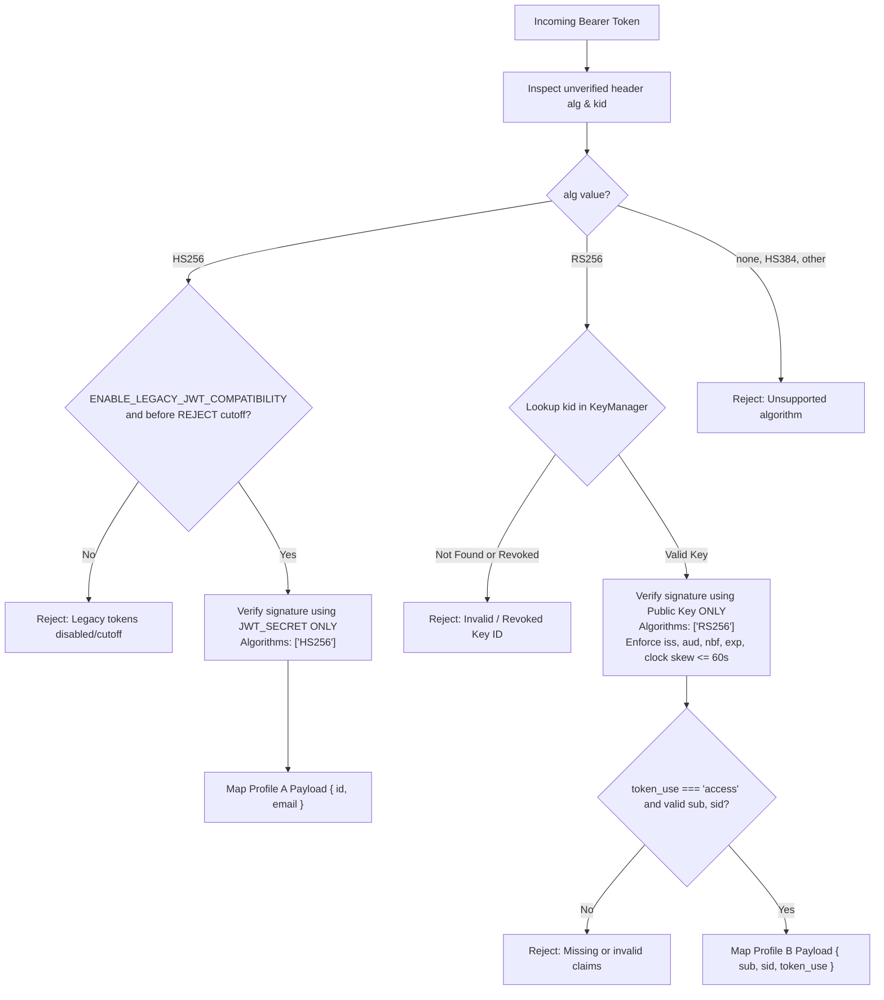

# M1.4.3 — JWT Security Engine & Dual Verification Architecture

**Status:** Completed  
**Milestone:** M1.4 (Sub-stage M1.4.3)  
**Implementation Source:** `backend/src/auth/jwt-engine.ts`, `backend/src/auth/key-manager.ts`  
**Test Suite:** `backend/tests/jwt-security-engine.test.ts`

---

## 1. Executive Summary

Sub-stage M1.4.3 delivers AuraClave's dual-verification JWT engine. The design guarantees full backward compatibility for existing 30-day HS256 tokens while introducing a short-lived, cryptographically isolated asymmetric RS256 token engine for future access control.

Key architectural properties:

- **Strict Cryptographic Isolation:** The symmetric `JWT_SECRET` is never passed to asymmetric verifiers, completely eliminating CVE-class algorithm confusion vulnerabilities.
- **Dual Verification Profiles:** Profile A (legacy HS256) and Profile B (modern RS256) are dispatched exclusively based on validated headers and configuration flags.
- **Modern Claims Enforcement:** Enforces RFC 9068-aligned JOSE headers (`alg: "RS256"`, `typ: "at+jwt"`, `kid`) and mandatory payload claims (`sub`, `iss`, `aud`, `exp`, `nbf`, `jti`, `sid`, `token_use: "access"`).
- **Key Rotation & Revocation:** Provides an in-memory key manager supporting active signing keys, verification keys by `kid`, and explicit key revocation.

---

## 2. JWT Profiles Specification

### 2.1 Profile A: Legacy HS256 Profile

- **Cryptographic Algorithm:** Strictly `["HS256"]`.
- **Key Custody:** Symmetric `JWT_SECRET` loaded from environment.
- **Token Lifetime:** 30 days (`expiresIn: "30d"`).
- **Header:** Standard unconstrained `typ: "JWT"`.
- **Payload Claims:**
  - `id`: User UUID string.
  - `email`: Normalized email string.
  - `fullName`: Optional string.
  - `avatarUrl`: Optional string.
- **Enforcement Rules:** Active only when `ENABLE_LEGACY_JWT_COMPATIBILITY=true`. Tokens presented after `REJECT_LEGACY_JWT_AFTER` are rejected immediately.

### 2.2 Profile B: Modern RS256 Access Token Profile

- **Cryptographic Algorithm:** Strictly `["RS256"]`.
- **Key Custody:** RSA 2048-bit asymmetric key pair. Private key held securely; public key identified via `kid`.
- **Token Lifetime:** 10–15 minutes (default `ACCESS_TOKEN_TTL_SECONDS = 900` / 15 minutes).
- **JOSE Header:**
  - `alg`: `"RS256"`
  - `typ`: `"at+jwt"`
  - `kid`: String matching an active public key in the key manager.
- **Payload Claims:**
  - `sub`: User UUID string.
  - `iss`: Configured issuer (default `"auraclave-api"`).
  - `aud`: Configured audience (default `"auraclave-app"`).
  - `iat`: Numeric timestamp (issued at).
  - `nbf`: Numeric timestamp (not before).
  - `exp`: Short expiration timestamp (`iat + ACCESS_TOKEN_TTL_SECONDS`).
  - `jti`: Unique UUIDv4 token identifier for correlation.
  - `sid`: UUID of the associated session family.
  - `token_use`: Strictly `"access"`.

---

## 3. Cryptographic Isolation & Security Guarantees

### Defense Against Attack Vectors:

1. **Algorithm Confusion (CVE-2015-9235, etc.):** An attacker cannot sign an RS256 payload using the public key as an HMAC secret because the legacy verifier uses only `JWT_SECRET` and modern verifiers never execute HMAC routines.
2. **Unsigned Tokens:** Tokens specifying `alg: "none"` fail immediate inspection and are rejected.
3. **Cross-Purpose Substitution:** Tokens minted with `token_use: "refresh"` or missing `token_use: "access"` are rejected by the modern profile validator.
4. **Key Revocation:** Revoking a `kid` in the key manager takes effect immediately, rejecting any further tokens signed with that key even if unexpired.
