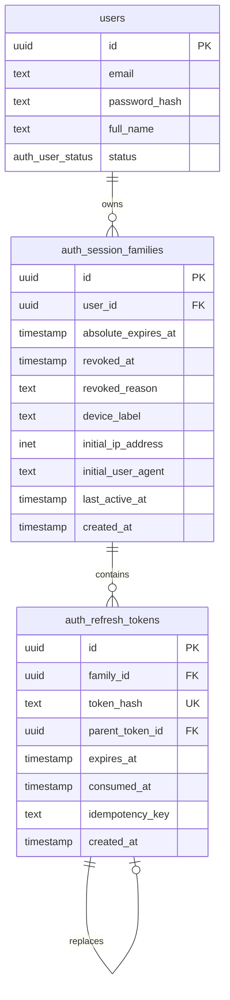
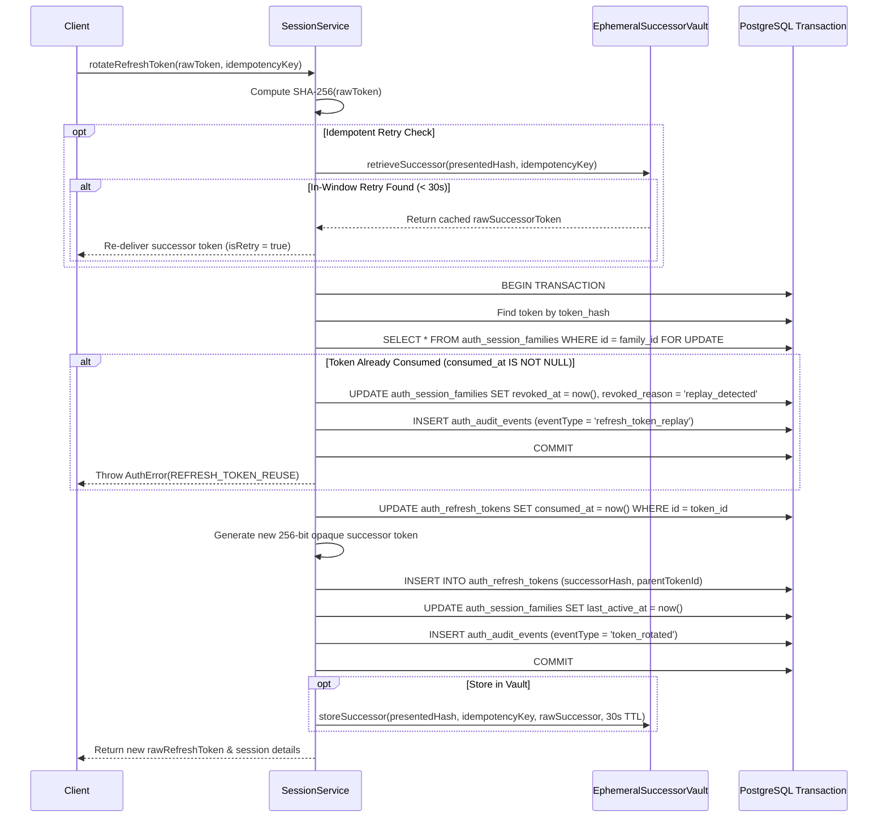

# M1.4.4 — Session & Refresh Token Infrastructure

**Status:** Completed  
**Milestone:** M1.4 (Sub-stage M1.4.4)  
**Implementation Source:** `backend/src/database/schema.ts`, `backend/src/repositories/session-service.ts`, `backend/src/auth/refresh-token.ts`, `backend/src/auth/successor-vault.ts`  
**Migration:** `backend/drizzle/0003_thin_tyrannus.sql`  
**Test Suites:** `backend/tests/refresh-token-vault.test.ts`, `backend/tests/database.integration.test.ts`

---

## 1. Executive Summary

Sub-stage M1.4.4 establishes AuraClave's future PostgreSQL-backed session and refresh-token infrastructure while maintaining the existing JSON authority as active.

Key deliverables:

1. **Dedicated Two-Tier Session Schema:** Implemented parent `auth_session_families` and child `auth_refresh_tokens` tables per the M1.3 architectural recommendation, accompanied by a clean forward-only Drizzle migration (`0003_thin_tyrannus.sql`).
2. **Opaque 256-Bit Refresh Tokens:** High-entropy base64url-encoded random tokens hashed via SHA-256 before storage; raw tokens are never persisted in the database.
3. **Transactional Rotation with Explicit Row-Locking:** Uses `SELECT ... FOR UPDATE` on parent session families to serialize concurrent refresh operations and guarantee that exactly one successor is minted per generation.
4. **Safe Response-Loss & Bounded Idempotent Retry:** Solves the "lost network response" problem using an ephemeral encrypted successor vault (AES-256-GCM, 30-second TTL) keyed by `hash(presented_token + idempotency_key)`.
5. **Immediate Replay Detection & Family Revocation:** Presentation of an already-consumed token outside the idempotent retry window triggers immediate revocation of the entire session family, invalidating all associated tokens.

---

## 2. Database Schema Architecture

The session architecture follows the normalized parent/child model:

### 2.1 Table: `auth_session_families`

Represents the persistent client device or browser authorization lineage:

- `id`: Primary key (UUID).
- `user_id`: Foreign key referencing `users.id` with `ON DELETE CASCADE`.
- `absolute_expires_at`: Hard cutoff timestamp (default 30 days from creation). Cannot be extended.
- `revoked_at` / `revoked_reason`: When populated, invalidates all child tokens immediately.
- `device_label`, `initial_ip_address`, `initialUserAgent`: Bounded client metadata for user device management.
- `last_active_at`: Updated upon each token rotation.

### 2.2 Table: `auth_refresh_tokens`

Represents individual single-use refresh token generations:

- `id`: Primary key (UUID).
- `family_id`: Foreign key referencing parent `auth_session_families.id`.
- `token_hash`: Unique SHA-256 hex digest of the raw token.
- `parent_token_id`: Self-referencing link to previous token generation.
- `expires_at`: Inactivity expiration timestamp (default 7 days, capped by family absolute expiry).
- `consumed_at`: Set when token is rotated.
- `idempotency_key`: Client-supplied idempotency key used during rotation.

---

## 3. Transactional Rotation & Concurrency Flow

When a client presents a refresh token to `/api/auth/refresh`:

---

## 4. Idempotent Retry & Response-Loss Security Evaluation

### 4.1 The Lost Response Threat

On unstable networks (mobile cell handoffs, flaky Wi-Fi), an API client may send a refresh request, the server executes and commits the rotation transaction, but the network drops before the HTTP response reaches the client.

- Without retry handling: The client retries the same token. The server sees the token is consumed and revokes the session family, logging the user out spuriously.
- With unrestricted grace periods: An attacker stealing a token can replay it multiple times within the grace window.

### 4.2 The Solution: Distributed Ephemeral Encrypted Successor Vault

- The client provides a unique `Idempotency-Key` (UUIDv4) on refresh attempts.
- When rotation succeeds, the newly generated raw successor token is encrypted using AES-256-GCM and stored in a shared distributed transient store (`ITransientStore`, backed by Redis via `RedisTransientStore` in production, or `InMemoryTransientStore` in local test environments).
- The storage record is keyed by a SHA-256 derivation: `auraclave:retry:hash(presented_token_hash + idempotency_key)`.
- It is stored with an exact 30-second TTL (`EX 30` in Redis).
- If the client retries with the exact same token and idempotency key within 30 seconds (whether routed to the same backend node or a different backend node), the vault retrieves the ciphertext from the shared store, verifies the AES-256-GCM authentication tag, decrypts, and re-delivers the identical successor token.
- If the token is presented with a *different* idempotency key, or after the 30-second window, the vault lookup misses, entering the database transaction where replay is confirmed and detected, revoking the session family.
- Raw successor tokens are NEVER stored in plaintext in memory, database, or shared cache.
- In production, when `ENABLE_REFRESH_SESSIONS=true`, `REDIS_URL` and `SUCCESSOR_VAULT_ENCRYPTION_KEY` (minimum 32 chars) are strictly required. If the shared store is unavailable, the service fails closed safely without leaking credentials.
